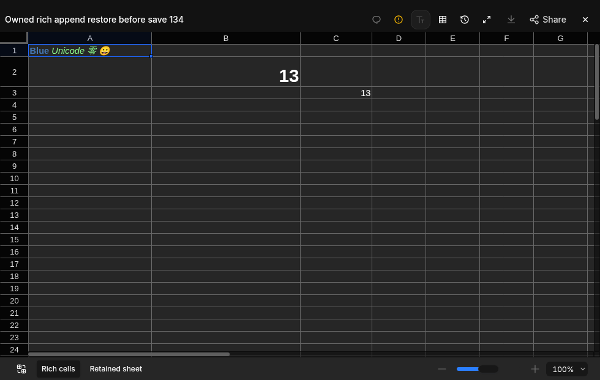

# Restored calculation and native media errors: candidate 134

This is bounded acceptance of local **134/77**, built from clean
`b6aad17f0e717e532411439c2c9a8cede2b3891c`, on Evebot
`77dde511c29b96b6347df38223989aa7904ec6bd`. It does not qualify the complete
artifact experience or update an installer descriptor, distribution or production.

The companion build is
`d62cf2ea05a532e0391d7d047010aeff9d7b63af1e65d8ff3860a2c9e58ce598`;
the local renderer image is
`sha256:2bbc59b9b1026d8de4107eeed7d23e84ab776c85450453671f4c8500cf1902a8`.
Author and independent root verification recomputed source identity, complete
package inventory, actual image payloads, embedded provenance, platform and
entrypoint. All five renderer payloads and 2,597 normalized inputs match 133.
All three builders exited 0 with no signal. Only the three owned preview
companion/renderer selectors changed; all other configuration bytes and data
were preserved. Receipts: `/tmp/artifact134-{pair-receipt,root-pair-receipt}.json`
and `/tmp/artifact134-env-proof.json`.

## Restored values before Save

A new owned TEAM workbook was uploaded through the production HTTP API. Its
original input B2 and stored local/cross-sheet results were 12. In the isolated
Chrome 155 browser, the tester stopped exactly one calculation Worker belonging
to that project, then used real pointer/key input to enter B2=13. The calculation
failure appeared, and the saved XLSX remained byte exact. After normal reload,
the real Restore draft action restored B2=13 and displayed both local C3=13 and
cross-sheet A1=13 **before Save**, personally inspected in Light and Dark.
The original XLSX remained 6,770 bytes, SHA-256
`c20f955801f3baaacaee4152c1c75ab9f2fa9a1eb9701500107e241dbadeb97b`.

Save produced numeric B2=13, local SUM cache 13 and cross-sheet cache 13.
Only the two corresponding worksheet parts and workbook metadata changed;
every other OOXML part remained exact. Clean reopen displayed 13, returned to
the stored-results notice and showed no unsaved draft or Save action. Its
6,776-byte source SHA-256 remained
`87ea99b1299c3c6a344f96f0eade1e01715d2d0ee3753e588bee9c94bd320d39`.
The screenshot below is the **saved, reopened** result, not a before-Save capture.

The private local evidence retains the actual before-Save screenshots in both
themes and sheets, XML oracle and source readbacks in
`/tmp/artifact134-root-ui/qualification.json`. The named browser closed normally;
the Worker observer stopped with exit 0, sign-out returned 200 followed by
session 401, and a read-only audit found all seven exact captured sessions absent.
The first iframe text wait timed out; scoped frame readiness subsequently passed.
No product failure or full permission-matrix claim follows from that setup wait.

At 390×844, the last contextual header action, Save, was clipped inside its
scrolling rail. Its 32-pixel box at x=272 was not visibly exposed beside Export.
The screenshot and box alone do not establish overlapping flex layouts. This
native header issue has a separate correction in progress and is **not fixed by
this fork change**. The narrow canvas also requires scrolling to reach B2/C3;
the narrow screenshot does not qualify their visibility.

## Genuine decoder failure and healthy comparator

The existing owned H264 MP4 was checked in two separate named browsers. In
Chromium 145, which reports no H264 support, its genuine decoder failure now
shows an accessible unavailable message and the existing Download/Open actions
instead of leaving unusable 0:00 controls. No error was injected. Light and Dark,
wide and 390-pixel layouts were personally inspected. The original Download
remained byte exact.

The exact same MP4 in Chrome 155 loaded all 6.6 seconds and played, paused,
responded to keyboard seeking, reached its natural end and replayed through the
actual pointer control. Both themes and sizes stayed healthy, without the error
alert, and the original download again matched the source. The final authorized
source read remained 278,102 bytes, SHA-256
`f84052102847d20d3d172901a41d186a6b303a50563f828cc716e57414059762`.
The fixture has no audio stream; this proves no audible quality claim.

Evidence: `/tmp/media134-ui/qualification.json`. Both browsers signed out
(200 then 401), closed normally with exit 0, and their two exact captured sessions
were absent in a read-only audit. Initial unsupported CLI viewport syntax,
iframe-text waits and settings-transition captures are retained as setup failures.
No codec installation, conversion job, source overlay or model call was used.
The rest of the media matrix was not rerun; HyperFrame volume-level and video
export capabilities remain separate open work.

## Source checks and limits

The joined source passed 87 Worker-free cases across five files, full workspace
types, guard and frozen install. Both unique production Node RPC scenarios
qualified across two runs: the first run passed the UNKNOWN-cache case but the
other case missed the unchanged five-second Worker startup bound before its
scenario; a selected retry of only that case passed unchanged. The failed first
run is retained in `/tmp/artifact134-rpc.log`; it is not reported as an entirely
passing run. No deadline, assertion or source was changed for the retry.

The real-browser check above closes the previously observed stale initial
restoration gap for this scalar fixture. Read-only/clean-input/ownership
negatives remain the source tests described in
[the calculation record](workbook-restored-input-calculation.md), not a newly
completed browser access matrix. Full history, array, recovery, permission,
cross-type and export acceptance remain open. Native document suggesting is a
separate unshipped change. Historical 132/133 receipts retain their original limits.
