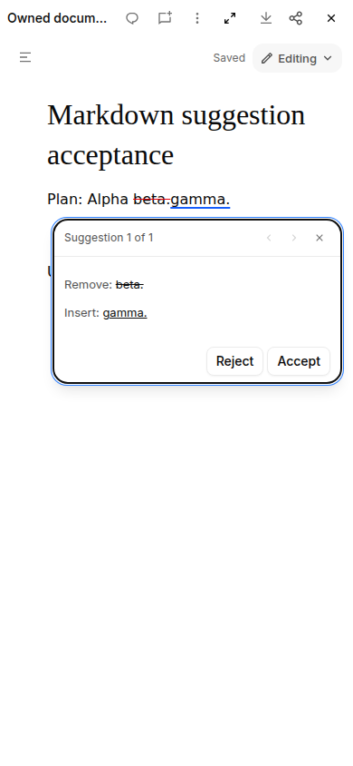
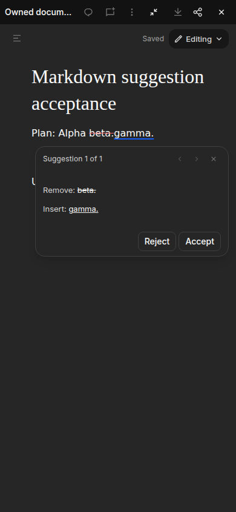

# Document suggestions and presentation entry: local acceptance

The local companion at source `9a2286dc40fd1dd7d69af90f29bd93a3978385bf`
was built and manually exercised inside Evebot's owned test stack. This document
qualifies specific observed flows, not the entire artifact feature or a release.
The source tests and unsupported suggestion operations remain described in
[document-suggesting.md](document-suggesting.md).

## Build and source checks

The immutable companion build is
`6c8d9bf3ddd3887bd080fb07bd3651380af4389c8e85551ead2e6551274f7beb`.
Its matching local renderer image is
`sha256:c16e3a1bad76c7f0e16bb0496c82b67a8289f3f051f62d0301fcd815409a69d1`.
All three builders terminated with exit 0 and no signal. Author verification and
an independent strict pair verification checked clean source, complete inventory,
actual image bytes/provenance and runtime entrypoint/user. All five renderer
payloads and 2,597 normalized worker inputs match the preceding local pair136.
This preserves prior converter evidence; it does not claim those jobs were rerun.

Joined source checks passed 285 web cases across 13 files and eight daemon cases
across two files, workspace types, guard, locale validation and frozen install.
The original first-review and font-history failures were reproduced and retained
before correction. Reviewers did not rerun the author's tests.

## Manual document checks

The real packaged UI was driven with a separate Chrome155 session and made-up
test account. Actions used the normal controls and trusted keyboard events;
source reads checked the same authorized conditional writer used by the UI.
No runtime patches, forced selection or history injection were used.

- A saved Markdown replacement retained the paired deletion/insertion proposal.
  Reject was the first content action after reopening. Focusing the editor and
  using native Undo restored the exact pending source SHA
  `0ebc1e55473a215f74a95b512e84f27637803160c82d4a2fa7fe300f6a0d8574`.
  Redo restored the exact rejected source SHA
  `6bb0882d5985a177f9684fa79b702d729cba39c49764dbb661aea94ac1399a65`.
  A final Undo left the original pending proposal restored.
- At 390px, closing the review card left a neutral 32×32 Review icon inside the
  existing 48px header, above the document heading. Focus returned to that icon;
  Enter reopened the card and Escape returned focus to the icon again.
- At a 1,140px companion viewport, the 320px card occupied the reserved side
  gutter: editor right 752px, card left 812px, card right 1,132px. The card did
  not cover document text. Light and Dark desktop and 390px captures were
  personally inspected. Narrow layouts use the bounded overlay; this is not a
  claim that the overlay leaves every following paragraph visible.
- In a reopened HTML document, Font → Text → Serif was the first content edit.
  Native Undo restored the exact initial Sans source SHA
  `59711f617bcd9f7e51bae13b7fcb598dfef3a4e1cd9a1de60a405d3d8018f50d`;
  Redo restored the exact Serif source SHA
  `954247016bb705795ad3c10eede9bf56a91d4607e25e5d37d71f57d5349bd91b`.
  A final Undo restored Sans. The rendered Dark document retained its heading,
  paragraphs and table.

## Presentation, comments and worksheet regression checks

Normal presentation entry was manually checked in Light/Dark at desktop and
390px. After the actual presentation frame loaded, Left moved from the third
slide to the second without a stage click. Representative Right actions returned
to the third slide. One Escape exited presentation and fullscreen. An immediate
Dark-phone opening capture was black; it was retained as an opening-state
observation, and acceptance used the actual loaded-frame focus witness rather
than a fixed delay or forced focus.

The desktop Dark presenter popup showed the second slide, its note, and previous
and next slide previews after Left. Escape closed that popup normally. This does
not claim every notes action was repeated in every size/theme.

In the comment composer, typing `@Ch` showed Chief while Add to chat remained
unchecked. Selecting Chief through the real suggestion control inserted the
mention and checked Add to chat. Composer body and chat draft survived Expand
and Restore with the same nodes. The comment was discarded and the chat draft
cleared without submission.

A previously saved workbook was reopened without editing. After resizing from
390px back to desktop, the visible canvas measured 980×532px inside the 980px
companion viewport and filled the available width. Its displayed local formula
result remained 14. Light and Dark captures were personally inspected. The
saved workbook SHA stayed
`3e2b7f1264f95f3a48f59db0f93f7a667dfcb733d02a2844cef7839cba39ea98`.
No new workbook write or export is claimed by this regression check.

Both named browser sessions signed out successfully, subsequent session requests
returned 401, and both browsers closed normally. A read-only query checked each
exact captured session ID in the owned test database; both were absent. No global
session deletion or claim was made. Light theme was restored; the presentation
fixture returned to slide1 with empty drafts, and the document fixture fonts and
pending proposal were restored as described above.

## Remaining qualification

This is a bounded text-suggestion implementation. Structural proposals, rich
paste, IME composition, accept-all, replies/attribution and native Word tracked
changes remain unsupported. Pending proposals must be resolved before converted
export. Local pair136 had a resolved Word download with checked OOXML and a
pending-export refusal; no external Office/LibreOffice visual acceptance or
new137 conversion run is claimed here. Rapid typing, platform IME refusal,
clipboard, table-cell input, concurrent source conflicts, permission withdrawal
and the complete locale/viewport matrix still need user-level coverage beyond
the source tests. Installer pins and production were not changed.
