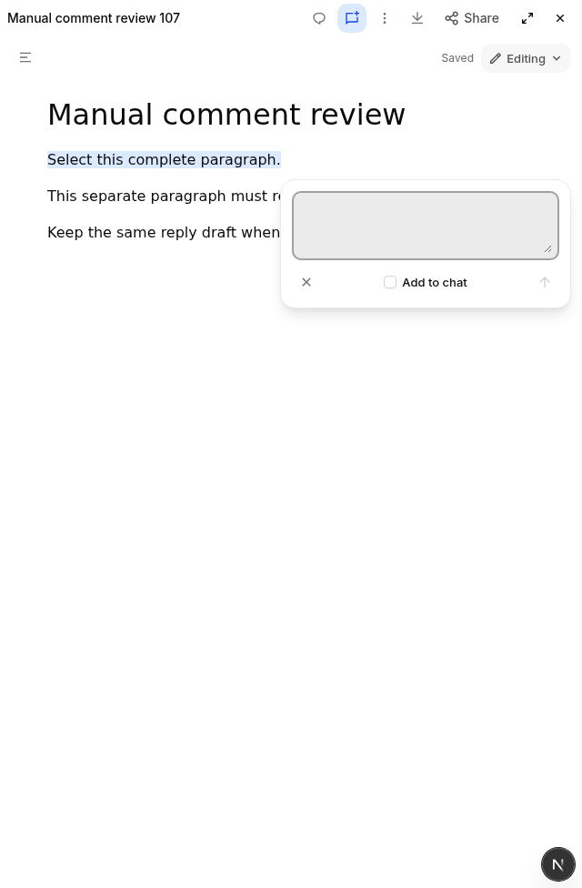
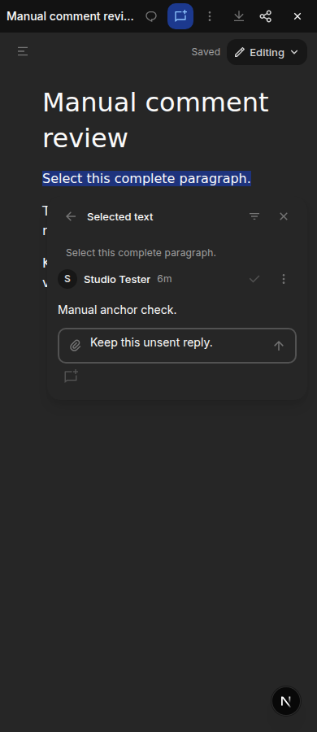

# Document comment selection checkpoint

This is a bounded interaction fix, not full Claude workflow or markup parity.
Production and shared development services were untouched. No comment was sent
to a chat during the manual acceptance checks.

## Reference-guided workflow follow-up (candidate 107 qualified)

The candidate105 evidence below remains historical. A later direct inspection of
our disposable Claude document showed that Comment without a selection opens the
comments list; an explicit Comment action on selected text opens a compact,
autofocused composer. Selecting text alone does not open it. A recipient mention
alone leaves Send disabled and Escape closes without discard confirmation.

The follow-up source implements that distinction: only a completed editor pointer
or keyboard gesture owns a retained selection across host-header blur. Saved
thread navigation does not restore Lexical selection. An exact CSS Custom
Highlight marks its range without changing editor state, native selection or
source. Unsupported Highlight API environments keep the thread available without
that visual mark. Highlight registry/style ownership is cleaned up on close,
range changes and editor teardown. The list leaves editing controls available.

The compact composer exposes the exact quote as an accessible description rather
than a repeated visible quote block. It retains existing comment authority,
conditional saves, reply drafts and discard confirmation. Known host bot mentions
alone are not substantive comment text; unknown handles, emails and mixed text
remain content. No automatic bot choice is introduced for multi-bot conversations.

Candidate107 passed the paired six-case browser suite and the bounded manual
checks below. This establishes the functional selection/comment checkpoint,
not full reference parity or cross-type feedback acceptance.

### Candidate106 rapid-input failures and source follow-up

Candidate106's first paired browser run passed selection ownership, explicit
header composer, passive highlight, accessible quote and mention-only validation,
then lost a letter during immediate typing after a mention. Three diagnostic
runs reproduced the loss. A transparent pass-through value observer showed the
browser had inserted the letter, then React committed the previous controlled
value during native input capture, before the authoritative change handler.
The element remained connected and editable, with no focus loss. The follow-up
moves menu/caret input bookkeeping into the bubble batch with that change handler.
It does not change typing speed or use forced synchronous updates.

A separate hydrated-document scratch browser also exposed reordered typing from
the old mention caret animation frame. A focused regression reproduced this
independently: after a mention and newer native input, the pending frame moved
the caret from 13 back to 7. Mention insertion now owns a receipt consumed only in
the layout commit accepting that exact value on the original textarea; newer
input, selection, pointer, keyboard or blur events invalidate it. No delayed
focus/caret write remains. The scratch browser is a bounded component proof,
not acceptance of the full candidate. Both fixes require the next paired native
browser run, including unchanged rapid typing assertions.

### Frozen candidate 107 provenance and acceptance

The qualified companion 107 / renderer 50 pair was built from clean source
`b25bd1726d0a3103e0e1fc78e17adcea49e446cb`. This later evidence-only commit does
not relabel that build.

- Source tree: `69da7e3506eb207ad1262da26e2455162d347fa80e615aa9c7f307b9c6bc9b27`.
- Companion: `0188ef0b1046ddacf82754bde7d8bb6c11d77fe5fc91a4031b1610a3329fab6e`.
- Renderer: `sha256:bd64ce6b4e535b782d0eb875edeec31b649ed95d009871ae8b862cebff9a90c6`.
- Worker: `03cfef8d890e7f1780a9bb1706e7a9f34335684bee64b6f1830fc32dad76ec9c`.
- Document-color helper: `a8935e725e3ddf66620ec72c356d7c270514c13977969a31c055eda29e7fed8c`.
- Native preview: `35595d371ee8fa7f3c3382c0bb29e3b8024d8b18`.

Strict companion inventory, clean source pairing, local immutable-image identity,
platform and entrypoint checks passed. The actual image worker/helper hashes
match candidate 106 / renderer 49. Owned preview shutdown and startup both exited 0;
login returned 200. Production, installer pins and publication were untouched.

Source validation passed 69 focused tests, full workspace typecheck, separate web
typecheck and guard. The unchanged six-case native browser suite passed in one
sequence on 107: four saved-comment cases at 1440/390 in light/dark, plus two
fresh-selection workflow cases at 1440/light and 390/dark. Exact rapid typing after
mention selection now passes; the 106 failures above remain part of the record.
The cases also assert passive ranges, accessible quotes, mention-only disabled
submission, source bytes, reload anchors, no stale thread selection and draft
retention. No delays, forced input or production DOM overrides were added.

The coordinator manually checked both themes on desktop and 390-wide layouts:
no-selection Comment opened the list with Editing/insertion still available;
a real full-paragraph drag followed by inline Comment opened an autofocused
composer, with an exact passive range and empty native selection. Keep editing
retained the draft; explicit Discard removed composer/highlight. Fullscreen and
restore kept the same iframe, document and input while preserving unsent comment
and chat drafts. Mobile Show chat/Return to artifact retained the same document
and reply node. List navigation hid that reply with zero rectangles and returned
the same DOM node and unsent text.

The fake manual artifact remained 328 bytes with SHA256
`66a16a21de900756016c1bfbb2db80fd143e488e4abefc0914fe4d131513a7b3`.
Its one saved comment resolved the generated block identity and exact offsets 0–31
for “Select this complete paragraph.” There were zero saved replies; temporary
reply/chat drafts were cleared. No chat handoff or external message was sent.

### Remaining reference and visual differences

The composer still has a nested gray textarea fill/focus ring, visibly heavier
than the reference's single-card treatment. The list fallback at a 640-wide
artifact pane overlaps the heading; narrow-reference comparison and placement
policy remain follow-up work. These observations are not claims of full visual
acceptance. Markup, cross-type anchoring and broader feedback refinements remain
outside this document-only checkpoint.

A fresh reference check also showed Escape discarding an unsaved substantive
comment body without confirmation. Evebot intentionally retains its protected
unsent-draft confirmation. No automatic recipient is chosen for multi-bot
conversations; only an explicitly entered known mention defaults Add to chat.
Host Show all versus in-card list navigation draft-confirmation consistency
remains a separate follow-up, without weakening existing draft protection.

## Candidate105 problems and resulting behavior

Opening Comment before selecting text previously left the selection prompt
unbound. The editor now waits for a completed pointer gesture or keyboard range
extension, then resolves the exact block identities, offsets and quote without
moving focus into the composer. Intermediate drag ranges do not become targets.
Existing drafts and saved threads retain their original target.

Manual inspection then found that the prompt itself could intercept a drag:
the native range ended in its hint text and highlighted the remaining document
and card. The unbound card is now pointer-transparent and nonselectable, with
its buttons and resize control still usable. The existing cross-root selection
refusal remains intact. The prompt can still visually occlude content; its
placement is a separate polish gap.

A retained thread also kept a `flex` display utility while its `hidden`
attribute was set, leaking a duplicate quote and chat button into the list. Its
container now uses explicit hidden/flex states. The thread stays mounted so
returning to it preserves the same reply textarea and unsent draft.

## Frozen candidate and evidence

Candidate 105 was built from clean `891c55c2ca43ca120f431af1c23a79a236503bc2`,
including the separately reviewed workbook style-guard merge. Later changes to
this PR contain tests, documentation and evidence only.

- Source tree: `b71611da8aaccfaae447ed48b26d4507cf9a45e3fa105a42e1751971a24e945b`.
- Companion: `c5ab8941abf875ae281280c3f16e19ef062a3cc1a9b94e6f4b95d96077f1c9ff`.
- Renderer: `sha256:4108ab99df0bc36ff0b0f51375d7d1fb63da4429da9a1e428d6de7c4b16a0cb0`.
- Worker: `03cfef8d890e7f1780a9bb1706e7a9f34335684bee64b6f1830fc32dad76ec9c`.
- Document-color helper: `a8935e725e3ddf66620ec72c356d7c270514c13977969a31c055eda29e7fed8c`.

The focused editor/anchor checks passed 33 cases. They cover completed pointer
and Shift ranges, collapsed selection refusal, authored/generated identities,
retained draft/thread targets, list withdrawal, source preservation and reply
state. Full workspace typechecking and guard passed for the implementation.
The passing class-name-only prompt test was removed: it mirrored utility names
rather than protecting hit-testing. Real browser acceptance owns that boundary;
all anchor, draft and source assertions remain.

Two real-browser cases passed at 1440/light and 390/dark. Each proved that the
physical pointer endpoint was inside the hint before release, no input appeared
mid-drag, and the completed quote appeared without focus theft. They also
checked real list visibility, the same reply DOM/draft after returning, generated
identities after reload and exact working-source bytes. The prior candidate's
1440 case failed at the expected missing-input assertion before this correction.
The complete six-case document-comments suite subsequently passed in one minute,
including the existing theme/size lifecycle cases. Its first attempt hit a
visually hidden native checkbox input; using the real visible label corrected
that driver target while retaining the same checked/unchecked assertions and
explicitly unchecked state before saving. No forced click or DOM setter was used.

Manual inspection additionally repeated the exact previously obstructed
paragraph in dark mode: the endpoint (1369,187) was inside the hint bounds
(1097–1415,162–194), but hit-testing reached the editor. Both native range
endpoints stayed in the paragraph, and release opened its entire quote. Light
390px inspection verified a complete wrapped quote and a clean list. Returning
restored the same reply node and exact draft; the draft was then cleared without
saving. The original generated document remained 321 bytes with SHA256
`cffe54d8c0ef295388223e206bb38fb366733728d9d66a10ba7a9c90bd96bab4`
and one preexisting comment. These checks do not establish universal browser,
reference UI or cross-type acceptance.

Local evidence is retained in `/tmp/comment-first105-green.log`,
`/tmp/document-feedback105-pair-receipt.json`, and the artifact-only screenshots
below. The source-independent archive and other renderer acceptance gates have
separate owners; this record does not claim publication or installer admission.

### Before: the prompt intercepted the paragraph selection

### After: only the complete paragraph becomes the target

### After: the phone-width list contains only its list rows

## Next reference-guided slice

A separate manual reference observation found that Comment without selected
text opens the comments list, rather than an unbound selection prompt. That
workflow needs a deliberate type-specific adaptation. An older Lexical selection
can also be reused after reply focus even when the current DOM range is empty;
that remains an explicit gap. Document markup, suggestions and broader comment
placement/interaction parity remain unfinished. This checkpoint does not silently
redefine those requirements as complete.
