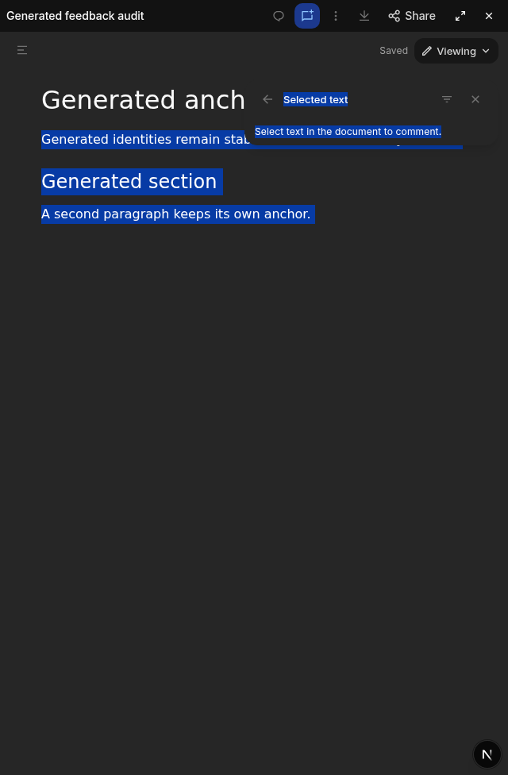
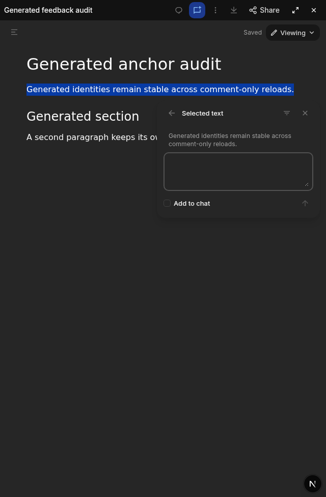
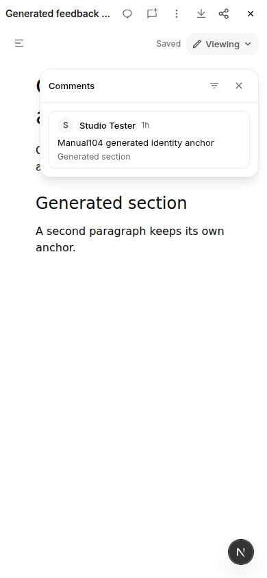

# Document comment selection checkpoint

This is a bounded interaction fix, not full Claude workflow or markup parity.
Production and shared development services were untouched. No comment was sent
to a chat during the manual acceptance checks.

## Problems and resulting behavior

Opening Comment before selecting text previously left the selection prompt
unbound. The editor now waits for a completed pointer gesture or keyboard range
extension, then resolves the exact block identities, offsets and quote without
moving focus into the composer. Intermediate drag ranges do not become targets.
Existing drafts and saved threads retain their original target.

Manual inspection then found that the prompt itself could intercept a drag:
the native range ended in its hint text and highlighted the remaining document
and card. The unbound card is now pointer-transparent and nonselectable, with
its buttons and resize control still usable. The existing cross-root selection
refusal remains intact. The prompt can still visually occlude content; its
placement is a separate polish gap.

A retained thread also kept a `flex` display utility while its `hidden`
attribute was set, leaking a duplicate quote and chat button into the list. Its
container now uses explicit hidden/flex states. The thread stays mounted so
returning to it preserves the same reply textarea and unsent draft.

## Frozen candidate and evidence

Candidate 105 was built from clean `891c55c2ca43ca120f431af1c23a79a236503bc2`,
including the separately reviewed workbook style-guard merge. Later changes to
this PR contain tests, documentation and evidence only.

- Source tree: `b71611da8aaccfaae447ed48b26d4507cf9a45e3fa105a42e1751971a24e945b`.
- Companion: `c5ab8941abf875ae281280c3f16e19ef062a3cc1a9b94e6f4b95d96077f1c9ff`.
- Renderer: `sha256:4108ab99df0bc36ff0b0f51375d7d1fb63da4429da9a1e428d6de7c4b16a0cb0`.
- Worker: `03cfef8d890e7f1780a9bb1706e7a9f34335684bee64b6f1830fc32dad76ec9c`.
- Document-color helper: `a8935e725e3ddf66620ec72c356d7c270514c13977969a31c055eda29e7fed8c`.

The focused editor/anchor checks passed 33 cases. They cover completed pointer
and Shift ranges, collapsed selection refusal, authored/generated identities,
retained draft/thread targets, list withdrawal, source preservation and reply
state. Full workspace typechecking and guard passed for the implementation.
The passing class-name-only prompt test was removed: it mirrored utility names
rather than protecting hit-testing. Real browser acceptance owns that boundary;
all anchor, draft and source assertions remain.

Two real-browser cases passed at 1440/light and 390/dark. Each proved that the
physical pointer endpoint was inside the hint before release, no input appeared
mid-drag, and the completed quote appeared without focus theft. They also
checked real list visibility, the same reply DOM/draft after returning, generated
identities after reload and exact working-source bytes. The prior candidate's
1440 case failed at the expected missing-input assertion before this correction.

Manual inspection additionally repeated the exact previously obstructed
paragraph in dark mode: the endpoint (1369,187) was inside the hint bounds
(1097–1415,162–194), but hit-testing reached the editor. Both native range
endpoints stayed in the paragraph, and release opened its entire quote. Light
390px inspection verified a complete wrapped quote and a clean list. Returning
restored the same reply node and exact draft; the draft was then cleared without
saving. The original generated document remained 321 bytes with SHA256
`cffe54d8c0ef295388223e206bb38fb366733728d9d66a10ba7a9c90bd96bab4`
and one preexisting comment. These checks do not establish universal browser,
reference UI or cross-type acceptance.

Local evidence is retained in `/tmp/comment-first105-green.log`,
`/tmp/document-feedback105-pair-receipt.json`, and the artifact-only screenshots
below. The source-independent archive and other renderer acceptance gates have
separate owners; this record does not claim publication or installer admission.

### Before: the prompt intercepted the paragraph selection

### After: only the complete paragraph becomes the target

### After: the phone-width list contains only its list rows

## Next reference-guided slice

A separate manual reference observation found that Comment without selected
text opens the comments list, rather than an unbound selection prompt. That
workflow needs a deliberate type-specific adaptation. An older Lexical selection
can also be reused after reply focus even when the current DOM range is empty;
that remains an explicit gap. Document markup, suggestions and broader comment
placement/interaction parity remain unfinished. This checkpoint does not silently
redefine those requirements as complete.
