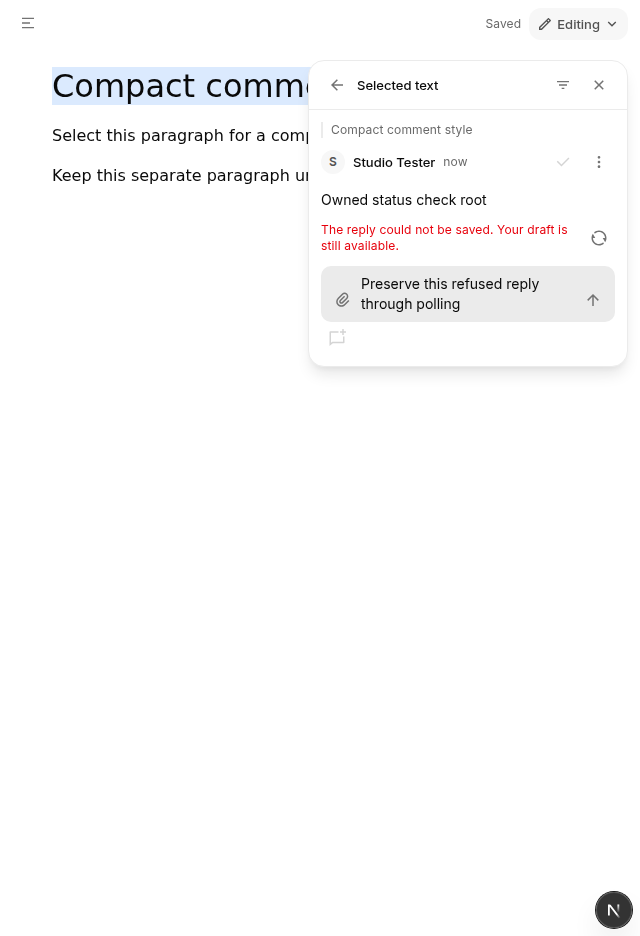
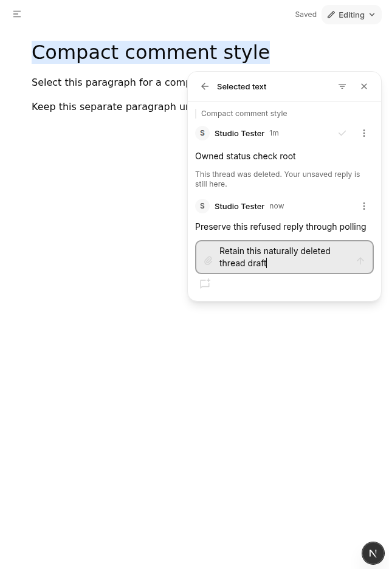
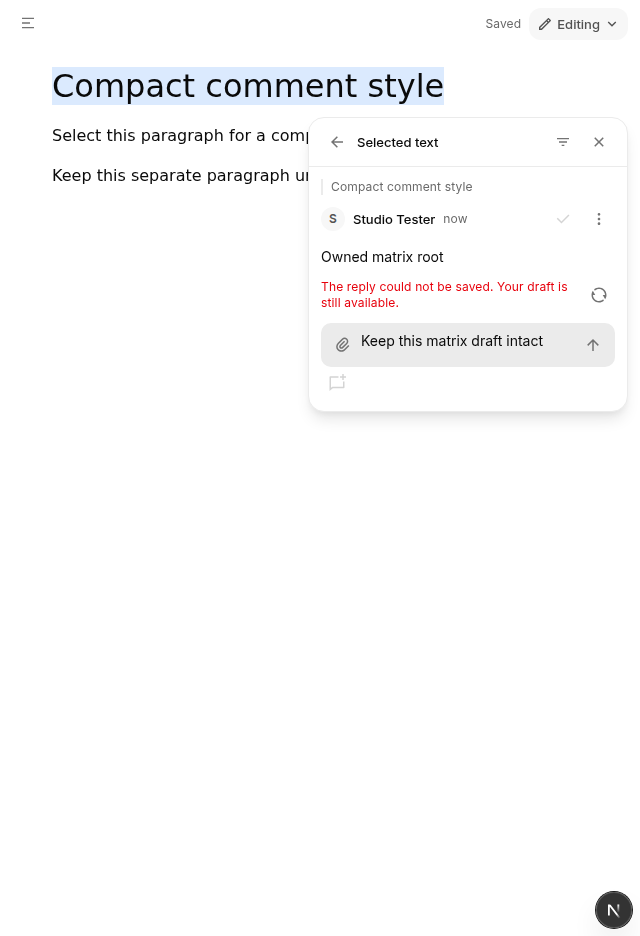
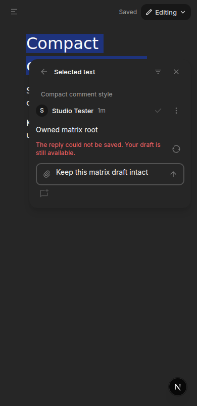
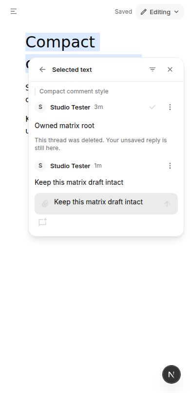
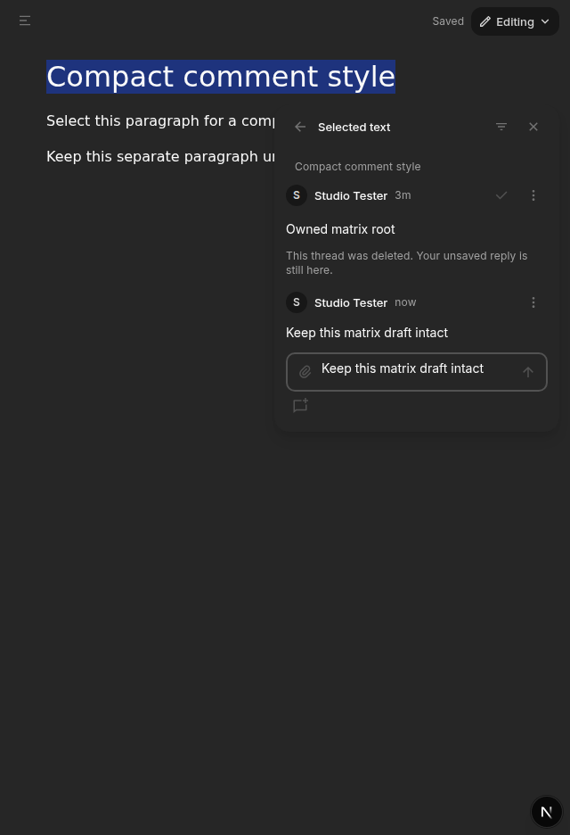

# Structured document comments

Rich HTML and Markdown documents use the same authorized project comment
storage, idempotent root writes, reply API, author permissions, status changes,
mentions and contextual Evebot chat handoff as other artifacts. Comment actions
come from the existing native artifact header; the document supplies a compact
resizable comments pane, not an HTML picker or a second editing surface.

## Anchor contract

The document identity adapter preserves existing block IDs across import/export.
Missing IDs on initial import are deterministic from the authorized source hash
and block ordinal, so comment-only reopen needs no document write. Subsequent
insertions/pastes keep the existing UUID ownership transform.
A version-1 structured anchor records start/end block IDs, UTF-16 text offsets
and the exact selected quote (up to 4,000 characters, offsets up to one million).
It is stored as inert versioned JSON with the `eve-document-anchor:` prefix in
the existing target `htmlHint`; `filePath`, `elementId`, selector and selected text
remain ordinary comment context. It never inserts a comment span into the file. A shared pure codec strictly
bounds the payload, identities and offsets. SQLite preserves canonical valid
structured anchors in the existing TEXT column; malformed/oversized reserved
payloads fail before writes. Generic HTML hints retain their old whitespace
normalization and 180-character limit. Saved-document chat context carries the
full bounded quote instead of the generic 160-character excerpt. Human-facing
quote previews also decode that payload; saved/editing thread quotes preserve
whitespace and scroll within a bounded focusable region. List previews remain
compact. Pointer and keyboard resizing both follow the pane's text direction.
A selected thread resolves only when both block identities, offsets and quote
still match. Changed/deleted text is explicitly unavailable; the thread remains
readable. There is no fuzzy retargeting or coordinate-based canvas selection.
Forward/backward selections, split inline text, Unicode, line breaks and
cross-block ranges are covered by actual Lexical tests. Viewing mode uses a
DOM text selection mapped through the current Lexical editor, without enabling
editing. Invalid/collapsed selections cannot reuse an earlier valid selection.

## Drafts, scope and permissions

Unsent roots, replies and pending chat handoffs participate in the existing host
navigation/beforeunload guard. Root CAS baselines, failed-save identity reuse,
reply revisions and attachment preservation use existing implementations.
Typing while an older save completes does not replace newer text. An agent's
file refresh waits while a comment draft is dirty. Explicit reload confirmation
also captures the document/comment revision so newer typing cancels that reload.
Viewer/project/file remounts withdraw old controls and asynchronous callbacks.
These composer drafts are in-memory, matching existing comment composers;
there is no new offline draft store or queue.

Author permissions come from the existing shared helpers and remain server
validated. Thread resolve/reopen and reply editing/deletion reuse the existing
components. `@` suggestions use only the current host-provided bot directory.
Adding a saved comment to chat stages its selection, note and file context;
it does not send a message autonomously. Rejected handoff remains retryable.

The paired native header recognizes additive `markupAvailable` (default true
for existing companions). Structured documents advertise false because this
slice supports text comments, not document markup. Other artifact envelopes
remain unchanged when that capability is omitted.

## Qualification

Focused component tests exercise the real Lexical editor, header control
receiver, composer/mentions, root/reply CRUD, resolve/reopen, foreign-author
affordances, draft retention, source refresh, confirmation races and chat
handoff. Existing comment-write/CAS/authority suites cover reused storage
semantics. No model calls, services, paired packages or Docker images were used. Only
owned source/dependency compilation was used for focused tests/types; the own
SQLite binding was verified against the pinned package and Node ABI.
Packaged persistence/reopen and visual acceptance in light/dark mode, chat-open
and full-screen layouts remain required; do not claim Claude visual parity
from these component tests. The retained reference records a compact selected-
content header, replies and Resolve. No fresh Claude session was available.

## Retained reply list navigation source checkpoint

Manual inspection of local companion 109 found inconsistent navigation: the
in-card All comments control retained an unsent reply without prompting, while
the native header's Show all comments asked to discard it. Accepting that
confirmation still retained the exact reply. The fake source remained 281 bytes,
SHA256 `3e7fb3c71f1d54177d778ff94a562504ae775c3732cd28176445556654b82cac`,
with one existing comment and no replies. The unsent draft was cleared and the
owned browser closed normally; no chat handoff was requested.

The next source change treats host list navigation as retention when a saved
thread is selected and its root is not being edited. It keeps that thread and
reply mounted, matching the in-card navigation behavior. Pending root operations
still block navigation. Leaving a new or edited root, closing a dirty reply, and
changing targets retain their existing draft protections. This is an observed
local consistency correction, not a claim about saved-reply behavior in the
reference product.

The actual component regression failed before the change because the denied
confirmation prevented the list from opening (36 other cases passed). The fixed
suite verifies the same reply and thread DOM identities, exact draft, no
confirmation, and no extra reply or document writes, plus pending-handoff and
dirty new/edit-root/close safeguards. Packaged browser acceptance of this source
change remains pending; candidate 109 keeps its original frozen source.

Review found a second inconsistency in the first source checkpoint: after
accepting discard for an edited saved root, returning from the list still showed
that root draft. A real component regression failed on this accepted edit path
while the accepted new-root case and 38 other cases passed. The handler now
resets any root composer after consent before listing comments; returning to a
saved row shows its persisted note. Denied new/edit consent and retained reply
navigation keep their separate protections.

### Removed-thread recovery source follow-up

A separate component refresh removed the selected root while its reply draft
remained mounted. Both list entrypoints hid that draft, but the persisted row
was gone, so there was no route back. Both recoverability regressions failed
before this follow-up (40 other component cases passed).

The list header now reuses a compact back icon labelled Return to deleted thread
only when its retained selection is missing from the current comments. It opens
the same retained thread and reply DOM with the exact draft. The existing deleted
notice, disabled submission, readable draft and close-confirmation behavior stay
in place. There is no fake persisted row, new storage, history or automatic write.
The recovery control is disabled during a busy root operation.

Viewing mode keeps the same member's retained reply available. A different
existing boundary remains unchanged: withdrawing the member identity resets the
reply scope and clears its draft before showing a disabled reply field. An
initial combined test incorrectly expected draft retention across that identity
boundary; separate final cases verify stable-member Viewing-mode retention and
identity-withdrawal reset/disabled-write behavior. This source checkpoint does
not claim cross-account draft retention. Packaged browser acceptance is pending.

### Expected missing-thread reads

The actual 112 deleted-thread walk-through retained the reply and disabled its
writes, but the reply poll's 404 also displayed the generic red Comments could
not be loaded message beside the accurate deletion notice. The next source
checkpoint distinguishes read failure from write failure. Only a typed 404 read
for a root already confirmed deleted uses the existing deletion notice alone.
An unconfirmed 404, permission/server refusal or network failure remains a
retryable load error; write failures remain visible even after deletion.

Initial-load and polling/deletion-transition component cases failed before this
change (two failures, 30 passing cases). Final cases retain the exact reply,
disable submission, cover 403/500/network errors and preserve a failed write.
Abort signals, request versions, thread/member reset, draft protection and the
underlying requests are unchanged. At this source checkpoint, packaged browser acceptance was still pending;
the candidate 113 record below qualifies this notice-only change.

Review additionally found that the existing quiet refresh cleared the shared
write-error state, even after a definite refused write. Two genuine regression
cases showed successful polling erasing 403/404 write messages without a retry
(two failures, 34 passing cases). Refresh now clears only its read-failure state.
Both quiet polling and explicit Reload comments retain a definite write or
attachment-validation message and the exact draft. A successful write retry or
resolving attachment action still clears its own feedback; a successful read
still clears its own load failure. This follow-up does not change request or
write admission.

### Local candidate 113 qualification

The clean frozen source is `7453a47c450f43695044fc6329f28d1d5f0c47cf`, tree
`5dade9b90a438f8e3108323ec4363c86b0512cb76fa610ad31eca9eaa8fb016b`.
Companion 113 is build
`de3ee6a98baf11be80a93bc9d62a6a976041b248b0c640b815d9eb3d13147b2a`;
renderer 56 is local immutable image
`sha256:7da7ad143191c2d13ea3a6fe36b1f0219d4f63af5f7b7312fa39bc2a6d5b2b56`.
Both sequential builders and Docker completed with exit 0. Strict full inventory,
clean source pairing, actual image worker/helper/provenance, architecture,
entrypoint and non-root user checks passed. Worker and color-helper bytes match
112/55; the image has this new source provenance. Later evidence commits do not
relabel that frozen source.

The owned 6261 preview used clean native
`a8f18276cd614a108d3a492fd660e4d21d59824c`. Standard shutdown and startup both
completed with exit 0, preserving data, proxy/model/browser configuration and
changing only the three candidate keys. No published archive, registry, installer
pin or production runtime changed.

Actual manual qualification used one made-up document in light mode at 1440×1000.
After saving its plain root with Add to chat unchecked, an external CDP listener
attached only to that named CLI browser. It fulfilled POST requests only for that
fixture's exact reply URL with 403. GET and unrelated requests continued normally;
there was no React/DOM state setter, source overlay or artificial timer. This is
HTTP refusal handling proof, not an authorization test.

A real successful quiet read and a real explicit Reload comments read both kept
the exact same textarea, complete unsent text and visible write-error message.
The artifact screenshots before and after those reads are byte-identical. The
listener then disabled Fetch interception, detached and disconnected with exit 0.
A normal server-backed retry saved the one plain reply and cleared its error and
draft. No comment or reply was staged or sent to chat.

A separate natural phase typed a new unsent reply and deleted that own root
through the owned stack’s normal API. The ordinary root/reply polling observed deletion
and a real GET 404. The same textarea and complete unsent draft remained, with
submission disabled and the accurate deletion notice, without a generic load
error or alert. Close→Keep editing retained the draft; it was then explicitly
cleared and comments closed. The source stayed 268 bytes with SHA256
`e97c6898583f52e73a25ff1c362ef1da245b7965febefead9b133d35b1d17c25`.
Final root count was zero after the own deletion, with no root composer, reply
draft or comment dialog remaining. The named browser closed normally and both
its process and the fault-listener process were absent.

Local receipts: `/tmp/document-comment-status113-pair-receipt.json`,
`/tmp/document-comment-status113-fault-events.json`,
`/tmp/doc113-status-after-quiet-read.json`,
`/tmp/doc113-status-after-explicit-read.json`,
`/tmp/doc113-status-natural404-proof.json`, and
`/tmp/doc113-status-final-proof.json`. Final source checks passed 83 focused cases
across the reply API, saved thread and document comments, full workspace types
and guard. This bounded run does not establish a new dark/phone/fullscreen
matrix, all-error permutations or full comment/reference parity.

### Candidate 113 extended manual matrix

A later manual run extended the same frozen 113/56 pair and native a8 checkpoint;
it did not rebuild or relabel 7453. A new own fake document was checked in all
four combinations of Light/Dark and 1440×1000/390×844, first with a retained
write-refusal message and then with a natural deleted-root notice. Actual
Settings radio actions changed the theme; every observation checked both the
host dark class and embedded `data-theme`. No localStorage-only theme assumption
or document reload stood in for those checks.

| State | Light desktop | Light phone | Dark desktop | Dark phone |
| --- | --- | --- | --- | --- |
| POST 403 write feedback | Same exact draft/error | Same exact draft/error | Same exact draft/error | Same exact draft/error |
| Natural GET 404 after deletion | Notice only; submission disabled | Notice only; submission disabled | Notice only; submission disabled | Notice only; submission disabled |

All eight observations retained the same iframe, document and reply textarea,
with the exact text Keep this matrix draft intact. All visible comment controls
were inside the artifact viewport. Desktop split content was 640×936 and phone
content 390×804. The document's Saved status remained visible. These are bounded
legibility/control-placement observations, not a claim of universal visual
parity; dark-card separation remains subtle with the current semantic surfaces.

The same owned-URL POST-only 403 fault left other requests untouched. After the
refusal, four real successful interval reads and one explicit Reload comments
read retained the error and draft. The listener's receipt records those 200s at
approximately 3.7, 34.0, 63.7, 73.7 and 93.7 seconds after the 403; the explicit read was
at 73.7 seconds. Fetch interception was removed, the target detached and the CDP
socket disconnected before a normal server-backed retry saved the own plain
reply and cleared its error/draft. This remains fault-response handling proof,
not permission/authorization proof.

A fresh unsent reply with the same comparison text was typed after that
successful retry. The subsequent own root DELETE and normal reply polling
produced a real 404.
Across all four views the deletion notice remained, the generic load error/alert
was absent, and submission was disabled without losing the draft. Dark desktop
Expand/Restore retained the same iframe/document/reply through 1140→640px content
widths during the write-error phase. Light phone Show artifact chat→Choose Chief→
Return to artifact retained the same iframe/document/reply and deleted-draft
state; no chat text, staging or sends occurred. Close→Keep editing also retained
that draft before it was explicitly cleared and the card closed.

Final source remained 268 bytes, SHA256
`2cddd831e78cb8d2faefe37776a9967622c8917bf5e83dec38e8c907897ad4d3`.
The own root count was zero after deletion; no comment dialog, root composer or
reply draft remained. The named browser closed normally, and both its process
and the fault-listener process were absent. Theme was returned to Light.

All eight screenshots were personally viewed. Four representative artifact-only
captures are retained below. During capture, two stale accessibility screenshot
references were refreshed from a new snapshot; the UI/source was not modified.
Per-view measurements/screenshots remain under
`/tmp/doc113-matrix-{write,deleted}-{light,dark}-{wide,phone}.{json,png}`;
network receipt `/tmp/document-comment-matrix113-fault-events.json`, actual 404
metadata `/tmp/doc113-matrix-natural404-requests.txt`, and final source/cleanup
proof `/tmp/doc113-matrix-final-proof.json`. The original 113 record above remains
its earlier light-desktop run; this addendum supplies the extended matrix.

### Floating card edge source checkpoint

Actual 113 inspection confirmed that the dark comment card's outer border and
background both computed to `lab(15.204 0 -0.00000596046)`: its separator token is
the same neutral 800 surface. The existing floating-panel border token instead
resolves to `lab(27.036% 0 0)` (neutral 700). Light mode maps both border choices
to `#ebebeb`, so the expected light edge does not change. The installed BoardUI
`MENU_POPOVER_SURFACE` already uses `border-border-button-default` on its primary
surface; the comment card now uses that semantic outer-edge token too. Its
internal header separator, surface, shadow, spacing, placement, focus and
handlers are unchanged. No raw palette value or new theme was introduced.

A read-only authorized reference inspection found a dark Comments region with
its own surface distinction, not the same layout/token system; it does not
justify copying a new theme. The own audit restored Light and closed normally,
and the reference card was closed without edits or sends. Actual next-pair
light/dark desktop/phone card inspection remains required: 113 retains its old
outer edge and is not relabelled by this source checkpoint. No class-name mirror
test substitutes for that visual gate.
