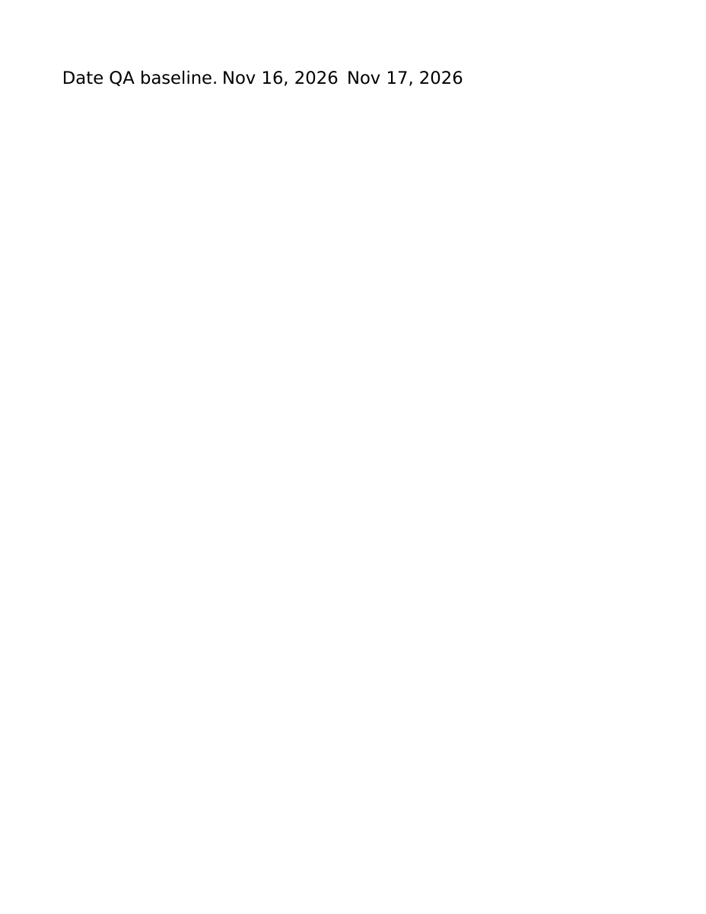
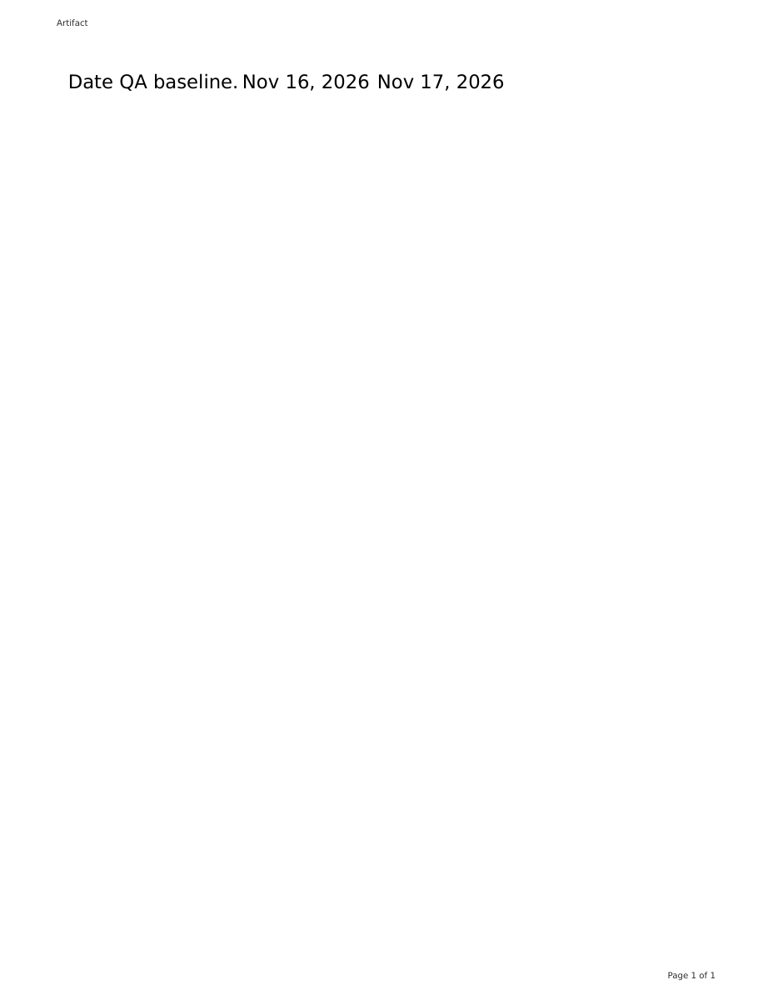
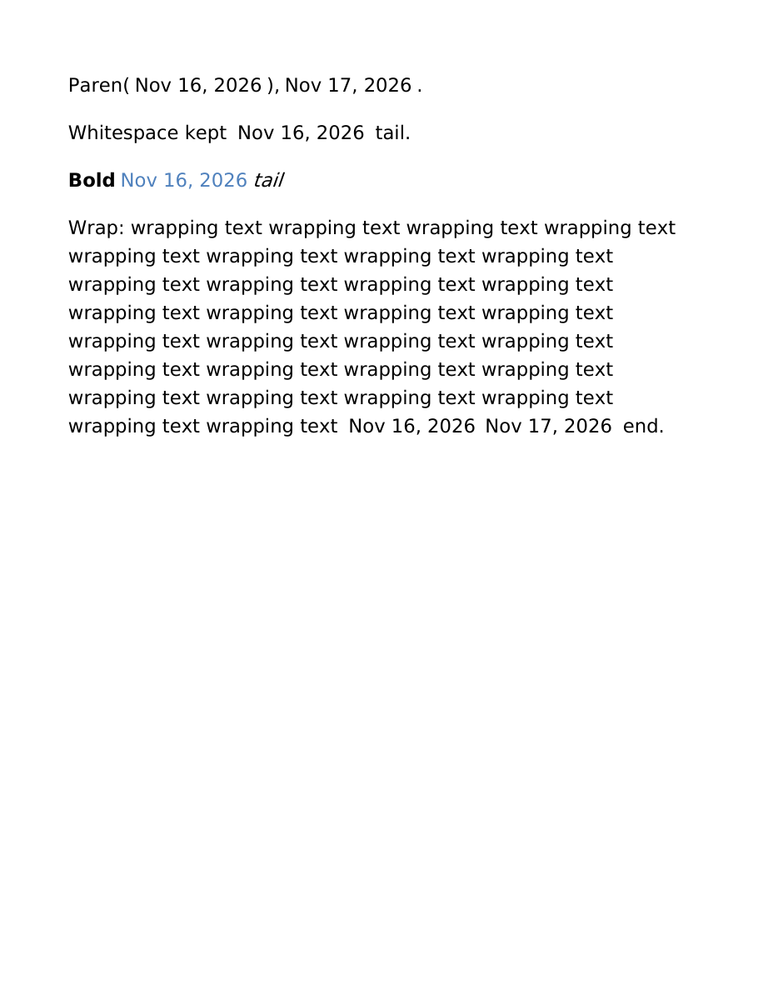
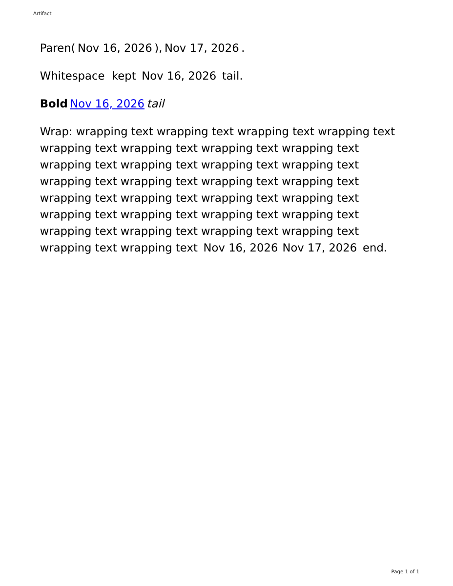

# Readable Date export boundaries

Source `224ba23f`, based on Date/focus `ed417056`, fixes conversion presentation
without changing the editor or saved document. The actual accepted fixture has
`Date QA baseline.` immediately followed by two canonical TIME atoms. The editor
separates its chips with `mx-1`; the old Word copy and PDF print had no equivalent
spacing, producing `baseline.Nov 16, 2026Nov 17, 2026`.

The immutable Date renderer reproduced this in a real DOCX opened by a fresh,
owned headless LibreOffice profile. Its output PDF failed the adjacent-label
readability assertion. The native PDF also had joined labels. Initial before
images and all four final consumer images were personally inspected. Exact
outputs, retained failures and logs are in the
[48-reference evidence record](document-date-export-spacing-evidence.json).

## Presentation projection

Word's conversion copy places U+2005 FOUR-PER-EM SPACE outside each validated
persisted label. This approximates a 4px chip margin at 16px; it is not an exact
geometry promise for every font or size. The label remains ordinary text, with
no fabricated Word date field/control. Surrounding formatting and hyperlinks
retain their existing owners. Existing neighboring source whitespace is not
normalized or rewritten by this projection.

PDF retains semantic TIME, ISO, locale and label. Only its derived print page
receives a scoped `margin-inline:4px` rule for validated reserved Date atoms.
The existing canonical print profile, its frozen fixture and all global geometry
remain unchanged. Validation runs before print presentation, and unresolved
suggestions still refuse all three converted formats.

Markdown deliberately retains the exact semantic TIME atoms without adding
presentation whitespace. Original accepted HTML stayed byte-identical at SHA256
`1521481d61343b8fcf975d04cd1cb79c9d2084da5216b9fa294fb6433fb87c45`.
ISO, locale and visible labels are never recomputed by this fix.

## Bounded qualification

- The final 64 daemon cases across seven files pass, including 11 new spacing
  cases, existing malformed/legacy Date controls, Markdown, Word presentation
  ownership and the unchanged canonical print-geometry golden. Full workspace
  types and guard pass. No full daemon/web suite was run.
- Eight real network-disabled, read-only renderer jobs pass with a read-only
  source-worker overlay in the existing Date image: Word/PDF/Markdown for the
  accepted source, Word/PDF punctuation/link/bold/whitespace/wrapped contexts,
  and three exact unresolved-review refusals. Two actual DOCX files open and
  convert successfully in independently owned LibreOffice profiles. PDF text,
  Word XML, exact Markdown atoms and source hashes are checked separately.
- Initial tests overasserted the legacy TIME's serialized markup despite
  existing generated owner spans; the correction checks its exact attributes,
  text and unchanged body instead. Two prior bare-label expectations now
  explicitly require the new Word-only boundary spaces. A broader regression
  caught an initial change to the frozen global print CSS; the implementation
  moved Date styling to its own scoped print tag, preserving that golden.
  All failed logs remain retained.
- All owned test containers and LibreOffice profiles' processes exited; scratch
  outputs remain for inspection. The owner's Chrome session, running preview,
  persistent fixtures, original source, Date frontend, workbook, models, pins,
  publication and Actions were untouched.

The Word consumer is LibreOffice, not Microsoft Word. The existing Pandoc
HTML-to-Word path can collapse repeated ordinary HTML whitespace; this bounded
fix does not establish general whitespace/export fidelity. It also does not
qualify every font/locale or a new immutable pair/native UI export replay.

