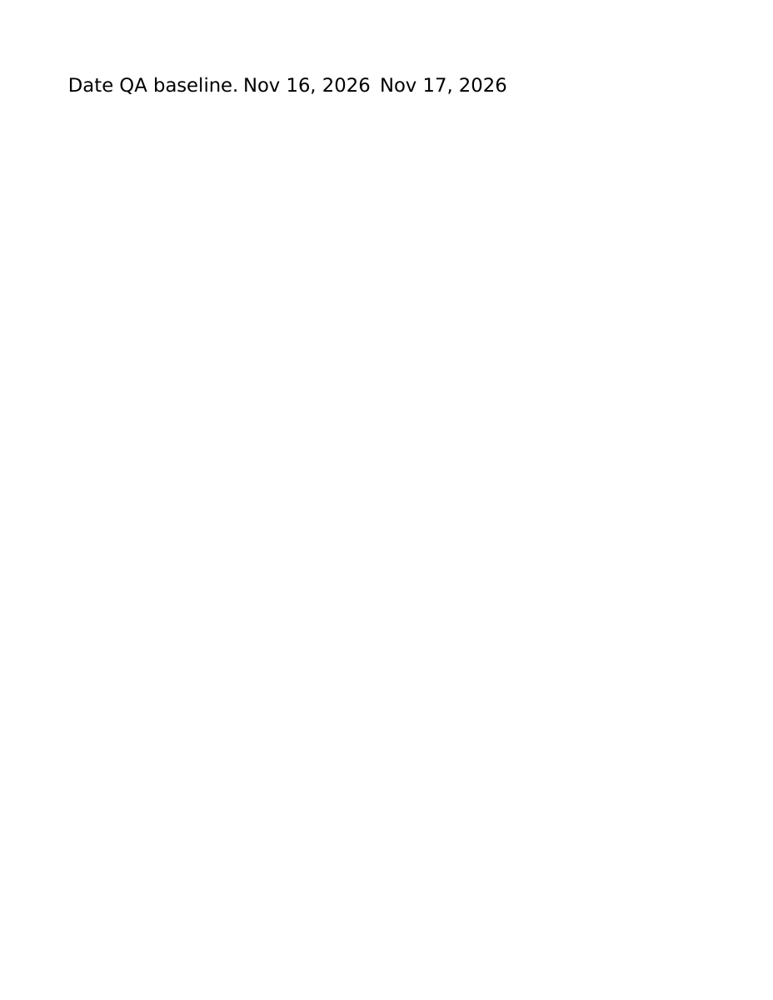
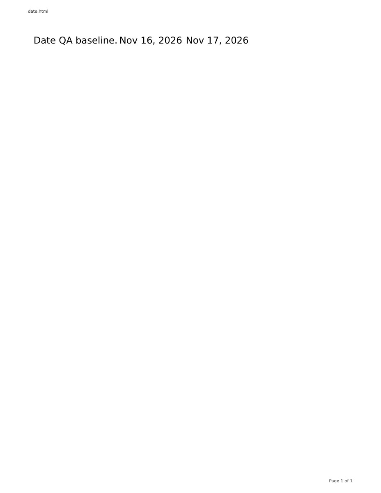
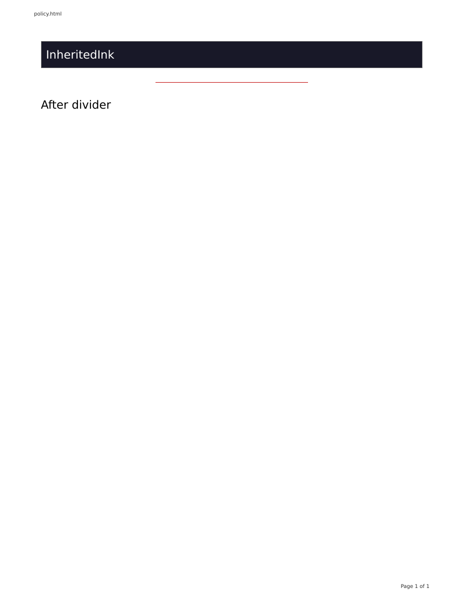
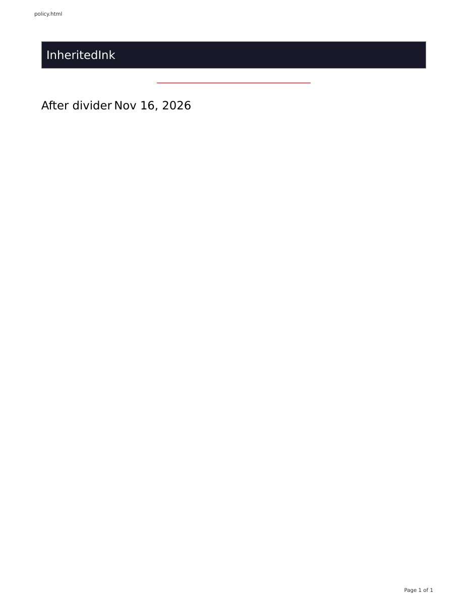

# Joined Date qualification

The joined source `a78a616f` combines atomic Date editing, native history/focus,
visible calendar navigation and corrected conversion presentation. Its bounded
native acceptance passed on an owned local stack with a made-up account and the
stand-in model. This does not complete the wider artifacts goal or publish a
feature release.

The exact joined source passed 154 web cases/10 files, 120 daemon cases/8 files,
99 shared-policy cases/8 files and 25 Date-contract cases/1 file. Frozen install,
dependency refresh, full serial workspace/scripts types and guard exited 0.
Independent source reviews cover the Date core, focus correction and corrected
PDF policy; reviewers did not rerun author tests. Earlier failures remain in
their owning checkpoint records.

Official sequential builders and strict verification exited 0 for companion
`e8e5ea87f46367aad9bfd1104478f488d970a7f1d900b57a0edcd21195943106`
and renderer `sha256:d3f5fd8988b655d333eacdc01103eca70f429959382692c58df57d18e8501939`.
The worker and document-color bundle changed; the other three runtime payloads
were actually rehashed and match the preceding pair. Old comparison uses its
retained strict receipt and immutable inventories, not an assumption that its
source checkout remained unchanged.

## Actual native UI and output

Manual native Export actions created eight fresh jobs: Word/PDF/Markdown for the
accepted two-Date document, three clear refusals for its separate imported
pending-proposal fixture, and two print-policy PDFs with/without a Date. Five
actual authenticated downloads returned 200 and matched recorded checksums.
DOCX opened in an independently owned LibreOffice profile, exited 0, and created
an inspected PDF. Its labels and the native PDF have readable boundaries.
Markdown retains exact semantic TIME atoms, ISO, locale and labels without the
Word-only quarter-em boundary spaces.

The two native policy PDFs visibly retain bright inherited text on a dark cell
and the authored red divider, with and without Date atoms. Unknown authored CSS
and legacy TIME refusal remain separately qualified source/worker controls;
these positives are not relabelled as a fresh all-case native policy matrix.
Date insertion Undo → immediate Redo also passed after final activation without
an intervening click; final Undo restored the original document.

Both original fixture hashes and both new disposable policy-file hashes stayed
exact, Saved, with no Save button or calendar left open. Normal restart retained
the same fake account/session and data. No logpoint or passive observer remained.
The context label was requested and author-tool-reported; cross-agent context
continuity was not independently established. The owned stack was retained for
the next qualification lane, so this is not a logout/teardown claim. Production,
the original owner preview, shared dev, installer pins and publication were
untouched. All [hashed evidence](document-date-final-evidence.json) retains its
scope and the icon-link lookup/read-only diagnostic mistakes separately.

This qualifies the named Date paths. General touch/IME, structural proposals,
all locales/fonts, arbitrary document whitespace, Microsoft Word itself and the
full artifacts permission/recovery/UI matrix remain separate workstreams.

