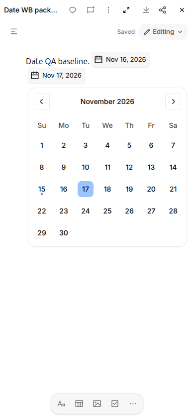
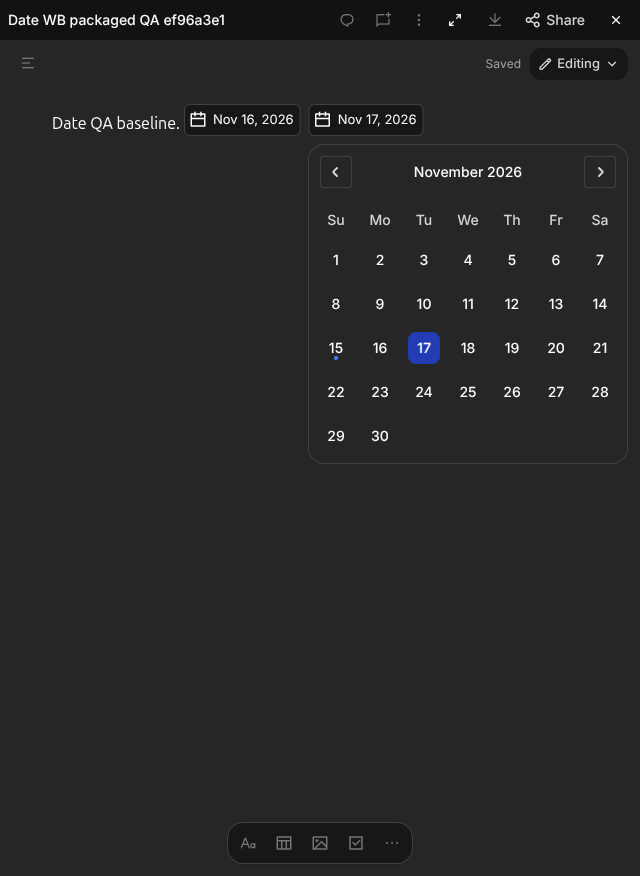

# Date history across preparatory commits

Actual acceptance of the preceding `ed417056` pair passed last-proposal
Accept/Reject → immediate Undo/Redo and visible calendar arrows in both themes
and desktop/390px layouts. Date insertion Undo still lost focus, despite the
mounted tests passing. No entire Date acceptance was claimed.

Passive DevTools logpoints in our own code established the ordering: a first
update consumed the captured focus while its Date control was still connected;
the restore guard correctly refused it. A later update removed the control,
leaving BODY focused with no capture left. Two logpoint-expression evaluation
errors were retained separately from product behavior. All logpoints were
removed after the observation; no SDK private fields were inspected.

Source `e0e665ec` retains the same short-lived capture through connected-control
updates and consumes it only once that exact control disconnects. Existing
expiry, editor/root/editability, active-document and other-input guards remain.
It neither handles history nor changes saved content. A controlled deferred
historic replacement through public editor operations failed before this change
and passes afterward. An earlier simple read-flush control already passed the
old code; it is not presented as the reproducer. The existing native Undo/Redo
and refusal cases remain intact. All 154 cases in ten affected files, full serial
workspace/scripts types, guard and independent source review passed.

The sanctioned builders produced and strictly verified companion
`b8003d69143581dd0a77fe945b69c29db0cb7db8c890af68612b37ca5d4f9a95`
and image `sha256:35cd5df7e928f4b3a3e5c5c3316509a2c0c32fec1302b07691f30898af7ef031`
from exact clean source. All three children exited 0. All five renderer payloads
and normalized inputs match `ed417056`; this correction changes companion UI.

The isolated local stack was restarted normally with the same fake account,
databases and files, without a reset. Actual More → Date → Escape → Undo moved
focus from the removed Date button to the editable textbox. Immediate Redo
restored the Date without any intervening click. Final Undo restored the original
two-Date document, Saved, with no Save button or calendar. Both fixture hashes
matched their originals; the fake session stayed valid. No observer or logpoint
remained. These checks did not repeat unchanged Review/arrow scenarios or claim
new Word/PDF behavior. The separate PDF style/Date-element ownership correction
and final combined qualification remain open.

The [hashed record](document-date-history-order-evidence.json) retains the actual
failure, controlled source regression, successful changed-pair check and setup
errors. The original owner preview, production, installer pins and releases were
not changed. The browser context label was requested and author-tool-reported;
cross-agent context continuity/isolation was not independently established.

The following calendar captures are from the preceding `ed417056` acceptance;
their visual source is unchanged by this follow-up. They are not screenshots of
the earlier failing zero-width glyphs.

