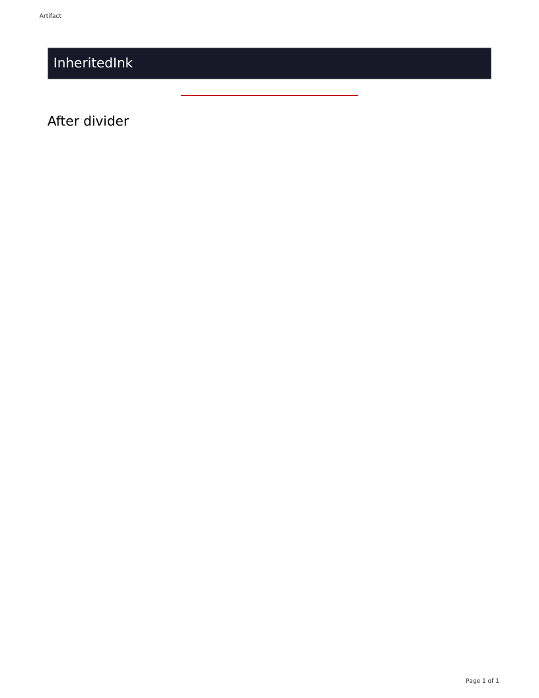
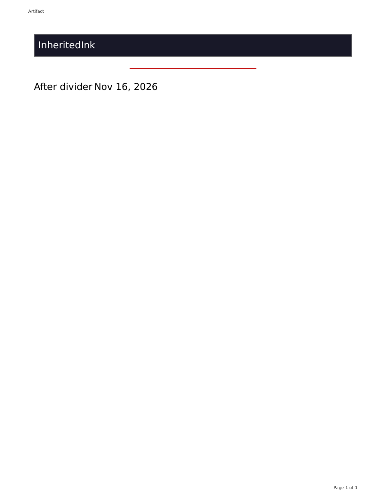
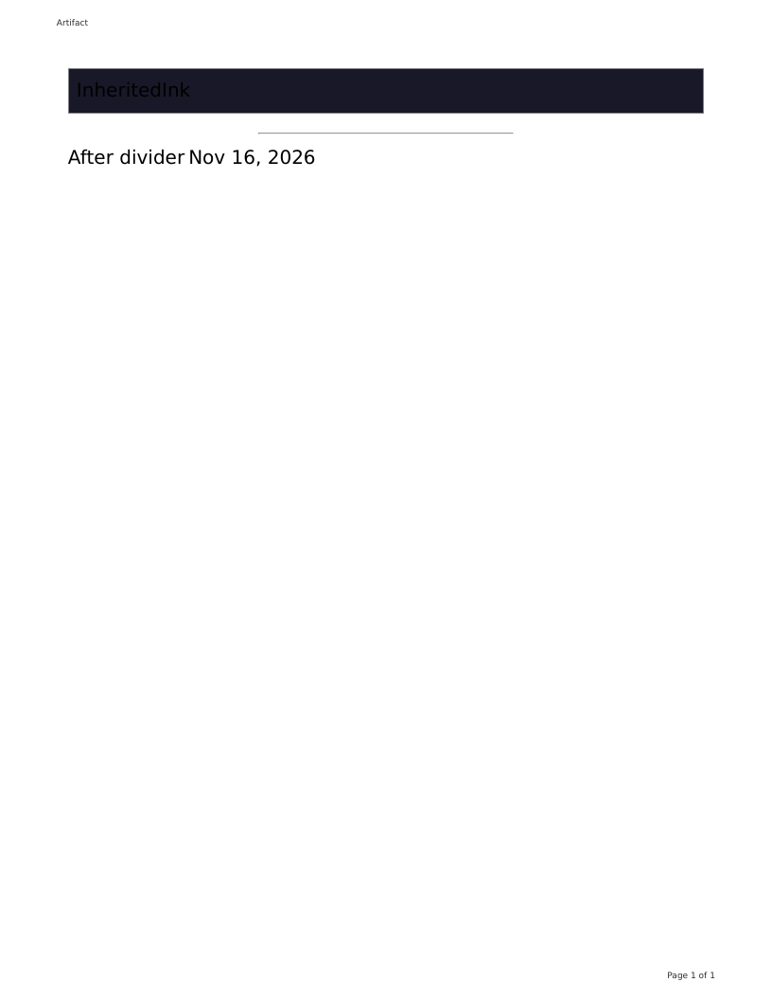
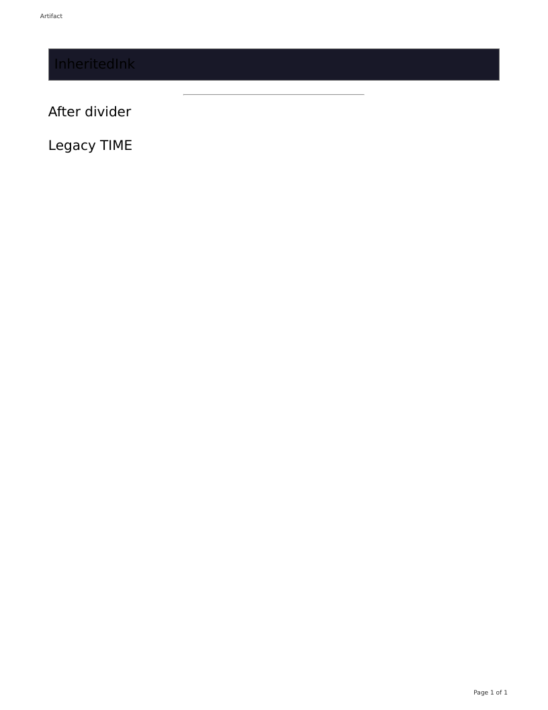

# Date print styling and the existing color boundary

Corrective source `7dc358c5` follows the initial spacing source `224ba23f` and
evidence `593d2c8a`. Independent review found a real regression missed by those
readability checks: the new Date print tag was absent from the color helper's
known-style list. Its unknown-style refusal therefore suppressed inherited-ink
and divider repair for canonical PDFs, even when they contained no Dates.
The earlier evidence is retained, not promoted into color-policy qualification.

An actual worker regression rendered a dark table cell needing inherited white
ink and a red divider. At the prior spacing source both had zero repaired pixels.
Moving the exact Date CSS into its owning PDF helper restored the no-Date case
to 302 bright ink pixels and 268 red rule pixels, while Date-bearing content
still failed: the shared qualifier did not admit TIME at all. These separate
RED and partial-GREEN receipts remain in the
[62-reference qualification record](document-date-print-policy-evidence.json).

## Narrow correction

Date style insertion and its exact known CSS now live together inside PDF repair,
and run only when validated source Dates exist. The global print profile and
authored-CSS acceptance policy remain unchanged.

The shared qualifier and ink repair accept an optional, default-empty set of
validated Date elements. The exception permits only connected HTML TIME nodes
with the canonical three attributes, text-only children, supported block context,
and valid Gregorian ISO/locale/label data. It cannot admit an arbitrary element,
foreign namespace, script, legacy TIME, malformed or stale node. Validation
reuses the existing pure Date contract through its additive package entry.

The PDF adapter supplies its already-validated source vector. Before each policy
call, the current DOM must match its exact count, order, ISO, locale and label;
extra or changed Date nodes refuse. These are presentation inputs, not edit,
access or approval authority. Other callers retain the default empty set.

## Current author qualification

- All 99 shared-policy tests across eight files pass, including 20 new Date-set,
  source-binding, tampering, namespace, context and unknown-style cases. All 120
  affected daemon tests across eight files, workspace types and guard pass.
- Four actual network-disabled worker PDFs pass with both current worker and
  current color IIFE overlaid read-only. No-Date and Date-bearing canonical
  fixtures both produce 302 bright inherited-ink pixels and 268 red rule pixels.
  Unknown authored CSS and legacy TIME still produce zero corrections. All four
  rasterized outputs were personally inspected. The negative captures below
  deliberately retain unresolved ink; they are refusal controls.
- Eight actual Word/PDF/Markdown/context/pending jobs pass again. An instrumented
  direct Node consumer exits 0 with no child signal or parent termination signal;
  both real LibreOffice conversions complete. Its four spacing captures are
  byte-identical to the four previously inspected captures. Original HTML and
  semantic Markdown remain exact.
- A prior pnpm consumer wrapper returned 143 after writing functional PASS and
  its receipt. Its cause remains unproven; the log is retained separately from
  the observed direct-child exit 0. An initial new pure package entry also lacked
  its explicit build entry; the normal builder now includes it. No assertion or
  authored-CSS restriction was loosened.

Owned containers and consumer processes are gone; scratch evidence is retained.
There is no new immutable pair, native UI replay, owner-browser interaction,
preview change, pin, publication, model/provider call or hosted Actions run.
Final distribution must rebuild and independently verify both changed payloads,
not overlay an old color helper under a new worker.

