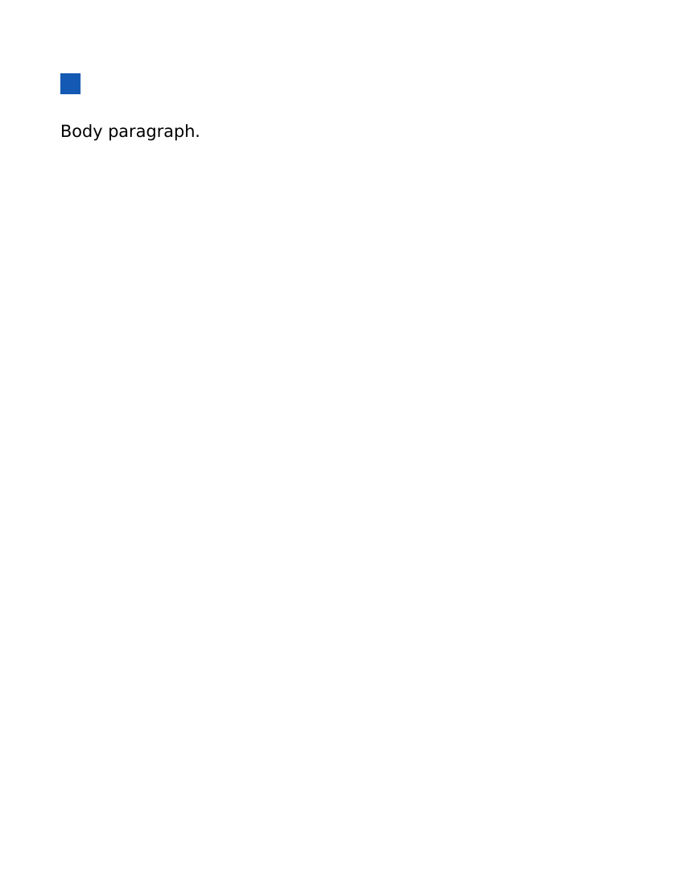
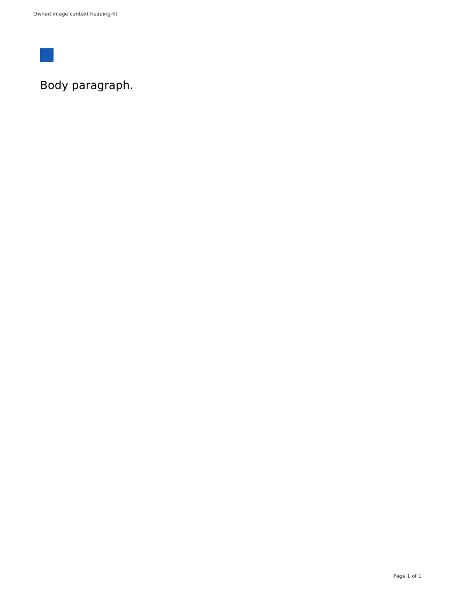

# Source-owned image-only heading lines

This checkpoint corrects the native Word placement of a single small baseline image in a qualified heading. It is an incremental export fidelity improvement, not general image-layout parity.

## Cause and ownership

The previous first-heading proof retained a real pixel failure: at 100 DPI the native Word image occupied `[88,78,111,103]`, while browser PDF occupied `[75,90,99,115]`. Complete ZIP copy probes isolated two independent defaults:

- Explicit zero DrawingML inline distances correct the horizontal offset.
- The existing `atLeast` paragraph line rule places an image-only heading higher than the browser's fixed heading strut. Keeping the same measured line height with `exact` corrects the vertical offset. Explicit inherited run/paragraph fonts, text alignment and top distance did not correct it. An added zero-width text strut was investigated but is not shipped.

The source annotator binds the actual `IMG` to its existing heading owner with a collision-checked temporary attribute. The contained DOM adapter qualifies only one baseline image with explicit positive integer HTML width/height attributes matching its measured size, no substantive text, a single measured line, matching inherited font context, no repositioning and an image that fits the line and physical print content width. Unproved relative/calculated CSS sizing, intrinsic sizing and authored container dimensions do not receive an exact-line receipt. The physical bound comes from the existing Letter/margin export profile; the normalizer's viewport and source CSS remain unchanged. One Chromium layout quantum (1/64 CSS px) is allowed when comparing its box and computed line height.

The Header AST must contain exactly that generated image identity. The native bookmark must delimit exactly one heading paragraph, with one embedded DrawingML picture and matching original dimensions. Only that image receives zero distances, and only that paragraph receives the measured exact line. First-heading `before=0` is a separate receipt; later heading margins and unrelated properties are retained. There are no source-added text struts, image raster substitutions or global drawing changes.

Tall/overflowing images, mixed text, multiple images, non-baseline alignment, no-wrap and changed inline font contexts do not receive this projection. Their previous behavior remains; their visual fidelity is not claimed. Paragraph images and mixed text/image lines remain next work, alongside the separately observed divider block-placement gap.

## Evidence and limits

The genuine shared-adapter RED expected the missing measured image receipt. Final focused checks cover eligibility, one-quantum bounds, wide responsive images, wrong image IDs, partial metadata, changed native dimensions, text, multiple/floating drawings and preserved native properties. Source-owned first-heading tests remain intact.

Actual contained source-worker proofs used local fake documents, original valid PNG bytes, network-disabled read-only containers and normal cleanup. These were **source worker/IIFE overlays on immutable renderer 53**, not a newly packaged image:

- Eighteen Word/PDF conversions covered fitting H1–H6 images, a neutral nested span, tall images and mixed text. Fitting cases use exact lines; tall and text cases retain their inherited `atLeast` rule. Source hashes and embedded image bytes were unchanged.
- Two additional conversions exercised the final stricter native picture/blip ownership checks.
- Seven independent LibreOffice 24.2 conversions covered H1–H6 and the nested case. Every original image-position oracle remained **less than five pixels on all four bounds**. H1 and the nested case produced Word `[75,91,99,116]` versus browser `[75,90,99,115]` at 100 DPI. DOCX hashes were unchanged by LibreOffice.

Scratch evidence: `/tmp/document-image-context-probes`, `/tmp/document-image-context-qualified-proof/{qualification.json,office/qualification.json}` and `/tmp/document-image-context-final-guard/qualification.json`. Earlier failed evidence remains: the original image pixel RED; incomplete initial scratch ZIP copies (invalid consumer evidence); an initial harness assumption that required a local line rule rather than resolving the inherited Heading style; and the conservative H5 eligibility miss before accounting for Chromium's layout quantum. No assertion threshold was relaxed.

At this source-only checkpoint, Microsoft Word itself and a newly packaged companion/renderer pair remained unverified; see the later immutable qualification below. The screenshots show the owned fixture only. This does not qualify arbitrary image positioning, all typography, tables, links, lists or page furniture.

Author checks: 38 shared document-style tests, 74 focused daemon tests, full workspace typecheck, final daemon/test typecheck and repository guard passed. There was no runtime restart, packaged image build, publication or production change.

## Ownership and collapsed-whitespace follow-up

Independent review found that checking for one image in the same native heading paragraph was insufficient: an empty owned bookmark range could coexist with an image outside it. The malformed native inputs were accepted before the correction, so the two new refusal assertions genuinely failed. The existing bookmark-stack traversal now records the actual inline picture while the exact heading owner is active; projection requires that exact element, not its paragraph position.

Real converter probes also confirmed a separate source case. Direct prettyprinted image headings passed, but a neutral nested span with collapsed whitespace failed on both the original checkpoint and the range fix: Pandoc emitted native space runs around the image. The correction proves that each original HTML-collapsible TextNode has no positive painted Range area, excludes NBSP, and declines image projection for inline background/border/padding/shadow/decoration contexts. Only that receipt permits removal of those whitespace nodes from the same captured conversion-only HTML copy before parsing. Source elements, authored attributes, media and the original file remain unchanged. Native text-run rejection remains strict; no native whitespace or visible characters are stripped by guess.

The new evidence contains six actual Word/PDF conversions: direct prettyprinted, neutral nested prettyprinted and visible NBSP. Both prettyprinted cases pass the unchanged LibreOffice image oracle at Word `[75,91,99,116]` versus browser `[75,90,99,115]`. NBSP remains native text and keeps its existing line behavior. The contained proofs use source overlays, not a newly packaged renderer or Microsoft Word. Evidence is under `/tmp/document-image-owner-proof`, `/tmp/document-image-whitespace-old469-diagnostic` and `/tmp/document-image-owner-whitespace-fixed` (its receipt map contains six conversions; an inherited scratch stdout label incorrectly says two).

Author checks: 42 shared tests and 77 focused daemon tests passed. The jsdom fixture models Chromium's `none` serialization for unset text shadow; pinned jsdom instead reports a bare transparent color. This stand-in normalization is test-only. The real contained browser/converter proofs do not use that shim.

## Sizing regression guard after the main refresh

The branch was normally merged with main `35fe182d`; the reviewed font/first-heading code and unrelated main changes were retained. Combined checks passed 42 shared and 116 daemon cases plus full workspace types and guard before the additional sizing qualification below.

Actual old-main versus candidate probes exposed a new false refusal. Both CSS `width:50%;height:24px` and CSS `width:336px;height:24px` exported on old main, but the pinned native converter ignored those CSS dimensions and emitted an intrinsic 304800×304800 EMU image. The candidate correctly detected a dimension mismatch but wrongly assigned that unproved source an exact-line receipt first. A bare intrinsic image had the same problem. In contrast, numeric HTML `width=336 height=24` produced 3200400×228600 EMU and exported on both sources. All original outcomes remain recorded, including the candidate failures.

Eligibility now requires concrete positive integer HTML dimensions matching the measured image, with no unproved CSS/ancestor geometry overriding them. The native extent check is unchanged. This restores existing exports for unqualified sizing; it does **not** fix the older CSS-sizing/intrinsic-DPI fidelity gap or declare responsive-image parity. Qualified source sizing, using actual print context and exact image/asset ownership to update both native extent and transform, remains explicit next work under the full fidelity goal.

Evidence: `/tmp/document-image-relative-comparison.json`, `/tmp/document-image-attribute-comparison.json` and `/tmp/document-image-sizing-guard-proof/qualification.json`. These are real pinned-converter source-worker probes with owned fixtures, not a new packaged pair or Microsoft Word verification. No source file or embedded image bytes were changed by conversion.

The post-guard run completed ten conversions across the original relative CSS, absolute CSS, intrinsic and HTML-attribute inputs plus a distinct fitted numeric control. All existing exports succeeded; unproved inputs retain `atLeast`, and the fitted numeric control retains `exact`. The original HTML width=336/height=24 control is tall under canonical `img{height:auto}` for the square PNG, so an initial harness expectation of `exact` was incorrect and remains recorded. The fitted control adds explicit CSS `height:24px`, agreeing with its numeric HTML dimensions and actual browser geometry.

Independent LibreOffice comparison of that fitted control retained a real old-main RED (`[88,78,436,103]` versus browser `[75,90,424,115]`) and achieved guarded GREEN (`[75,91,424,116]`) at the unchanged less-than-five-pixel oracle. Both pages were personally viewed. Source files, image bytes and consumer-input DOCX hashes were unchanged. Receipts: `/tmp/document-image-sizing-guard-proof/qualification.json`, `/tmp/document-image-fit-oldmain-proof/qualification.json` and `/tmp/document-image-sizing-office.json`. The old-main scratch stdout inherited an inaccurate `exact` label; its authoritative receipt records `atLeast`. Final post-guard checks passed 44 shared cases, 116 daemon cases, full workspace types and guard. No companion/renderer package build, runtime activation or publication occurred.

## Immutable pair 117 qualification

The reviewed image ownership, whitespace and sizing-compatibility changes were integrated with the divider checkpoint at source `4c6aad245519313ec305df574c840a1c16371183`. Companion 117 and renderer 60 were built from that clean source and verified as a matching immutable pair, without worker overlays. This is a local candidate, not a publication or installer-pin change.

Actual contained conversions covered 28 Word/PDF outputs across divider, sizing-guard and prettyprinted/NBSP fixtures. Independent image ZIP checks retained original media bytes and verified native extents/transforms. Eight image consumer comparisons yielded three qualified alignments within the unchanged less-than-five-pixel bound and five preserved legacy outcomes with known CSS/intrinsic sizing gaps. Those five are not fidelity passes. The consumer-input DOCX and source hashes remained unchanged.

Evidence: `/tmp/document-fidelity117-pair-receipt.json` and `/tmp/document-fidelity117-immutable/summary.json`. LibreOffice, rather than Microsoft Word, was the independent DOCX consumer. Packaged browser export interaction and Microsoft Word remain unverified for this pair. A separate print-context sizing correction is under review and is not included in this candidate.
