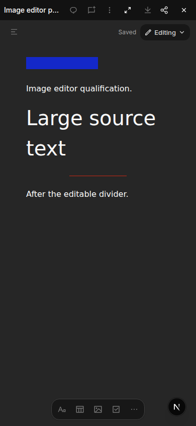
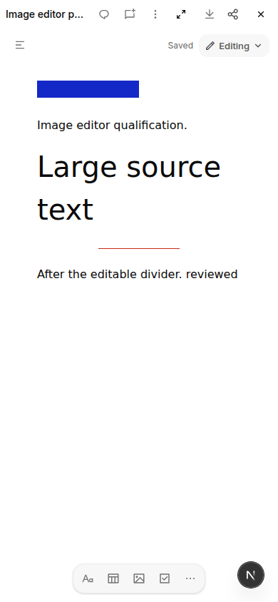
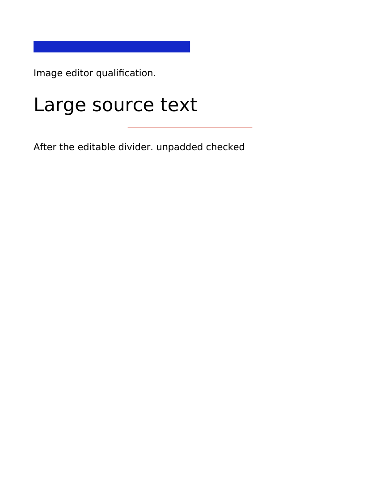
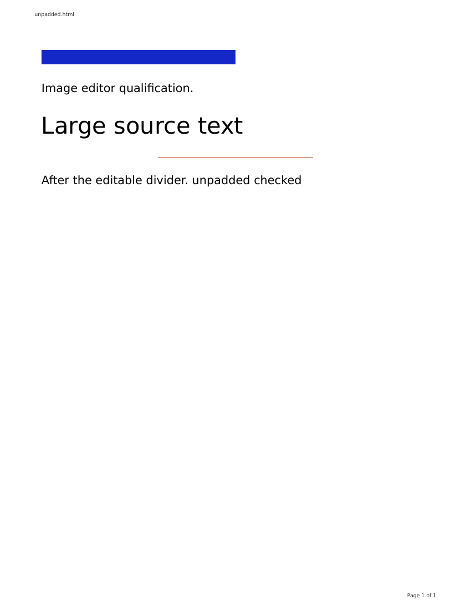

# Persistent document image dimensions

The packaged 118 export fixtures expose an editor availability gap: the export pipeline can measure image CSS, but the rich-document gate refused `height:24px` and `width:50%`. The image node also imported only numeric HTML attributes and always rendered `height:auto`. Allowing the source through that gate alone would silently lose its authored dimensions during editing/save. This checkpoint fixes source ownership; it does not copy the export renderer's physical measurement into the document.

## Source model

Numeric HTML width/height remain independent from optional authored CSS width/height. Intrinsic absence stays absent; explicit `auto` remains explicit. The existing image node's clone, JSON, DOM import/export and render paths retain these values. Source CSS units survive: positive px/pt dimensions within the existing 10,000px bound, positive width percentages through 100%, and auto. Height percentages, viewport units, expressions, CSS variables, important declarations and unknown styles remain on the original fallback path. The same small parser is used by admission, import and node validation; other element grammars are not widened.

The image renders its authored height instead of forcing auto, retaining the canonical max-width constraint. A width percentage remains responsive to the current viewer's containing block; no computed pixel width, preview measurement or 672px print-context result is stored. HTML numeric attributes are not replaced by CSS values. The export-time physical sizing producer remains separate.

A direct IMG's existing `data-od-id` now reaches the existing image NodeState identity. An owned wrapper with the same image ID denotes that one image, consistent with the existing wrapper import policy; canonical output has one wrapper ID. If only the inner IMG carries its ID, import retains it. Competing wrapper/IMG IDs refuse admission instead of silently dropping either identity. No URL, grant or new identity authority is introduced.

## Author proof and pending runtime checks

Six initial tests genuinely failed on unchanged main2948421b: three dimension-admission cases, two actual Lexical HTML→JSON→HTML unit-loss cases, and direct-IMG identity admission. The log is `/tmp/document-image-dimensions-red.log`. The correction passes those same assertions. Added cases cover legacy/intrinsic/auto controls, strict geometry rejection, unchanged non-image gates, image identity combinations, malformed serialized CSS values, and real Lexical history/clone preservation. The existing Markdown source-receipt/reopen path also retains percentage/point CSS units without inventing numeric HTML attributes.

Mounted real DocumentEditor tests import CSS percentage/point/numeric-attribute controls, edit unrelated text, save, Undo/Redo, unmount and reopen through DocumentSurface. They check the rendered image CSS, serialized source attributes/relative path and stable identities. This is component/source proof, not actual browser layout or packaged save/readback proof.

The initial runtime gate required independent review, normal integration with current main and a new matched package pair before browser checks. The later qualification below covers representative Light/Dark wide/phone editing, source readback, history, responsive sizing and exports. It is not the full cross-type interaction matrix; source overlays do not qualify an immutable pair.

The matching DocumentSurface suite retained a stale plain-HR fallback expectation from before the existing divider feature. The untouched 2948421b worktree and unchanged 24-case suite reproduced that same failure with 23 passing (`/tmp/document-image-dimensions-baseline-surface.log`). The negative fixture now uses genuinely unsupported `position:absolute`, and an added positive asserts plain HR opens the rich surface. All 25 Surface cases pass. This corrects test accuracy; no HR production admission was changed, no assertion was deleted or weakened to hide an image regression.

The preliminary matching suite had 175 passing cases plus the pre-existing Surface expectation failure. The final six-file suite passed 178 cases, including the 32-case image-dimension file and three mounted save/reopen/history cases. Full workspace types, final matching web types and repository guard passed. These source checks do not replace the pending immutable/browser acceptance.

## Local candidate 119/62 qualification

Clean integrated source `fd09b474df82251c1e281a6c5493e69a69cda193` produced companion119 (`db419b87a714f40c76776e134c219a493860afdc155c79b6c8928c7918400c95`) and renderer62 (`sha256:fc5ff2e714918df4b2cd27bf1b94fcd7aeb8883023e92b18e70a5149b6d896c9`). Strict verification checked inventory, clean source provenance and actual image bytes. Renderer worker/helper bytes equal the already qualified118/61 code: this change is editor behavior. Normal activation on the owned6261 preview preserved data and every configuration byte except its three candidate settings. Native source was `bb2ca196`, whose production code subsequently merged in Evebot PR76. No production or installer pin changed.

Actual manual UI checks covered unrelated text edits, automatic save and real reload/reopen for six fixtures: CSS50%/24px, numeric HTML24×24 with CSS height24px, CSS252pt/18pt, intrinsic absence, explicit auto and an unpadded data URI. Source readback retained authored units, independent HTML dimensions or their absence, image identity and original media bytes. The unpadded URI spelling also remained unchanged. Numeric, percentage and point cases additionally passed actual keyboard Undo/Redo across a saved state.

The percentage image resized from360×24px to143×24px in wide/phone layouts without a source write. CSS controls were personally viewed in Light/Dark wide/phone layouts; numeric was viewed on Light phone, point sizing on Light phone/wide, and intrinsic/auto/unpadded/fallback on Light wide. This is representative coverage, not every control in every theme/viewport combination. Unsupported calc geometry retained the original HTML viewer and byte-identical source.

Four actual UI exports from the edited numeric and unpadded documents reached ready: Word and PDF for each. Download sizes and SHA256 matched job receipts, saved text appeared in the files, and export left the saved source unchanged. Independent DOCX inspection verified original media, expected native image extents and editable dividers. The downloaded unpadded DOCX was rendered with LibreOffice and personally compared with its downloaded browser PDF. At100DPI the image bounds were Word `[75,91,424,116]` versus PDF `[75,90,424,115]`; divider bounds were Word `[286,283,563,283]` versus PDF `[285,283,564,283]`. Both retain the original less-than-five-pixel oracle. Text baselines and page furniture still differ.

An initial font-loss suspicion was contradicted by the before-edit receipt: it already specified serif, and saving retained it. No production font fix was made. Three additional positive font-preservation cases document this separately. With those test-only additions, the final six-file suite passed181 cases, and web types passed. Production code remains byte-identical to built sourcefd09; later test/docs commits do not relabel that build. Named test browsers closed normally.

Exact local evidence is `/tmp/document-editor119-pair-receipt.json`, `/tmp/document-editor119-env-proof.json`, `/tmp/document-editor119-browser/qualification.json`, its per-case receipts and `edited-four-export-proof.json`. This does not qualify Microsoft Word, JPEG rendering, arbitrary image CSS or full document fidelity. Separate workbook, access/recovery and cross-type gates remain open under the full artifact goal.
