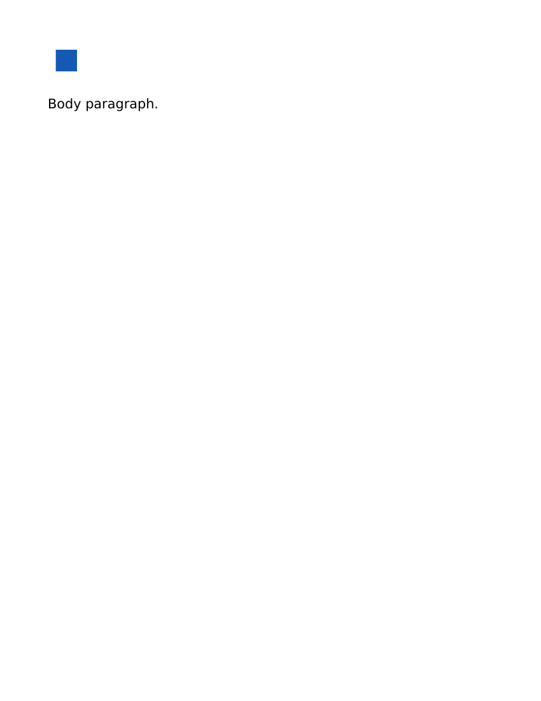
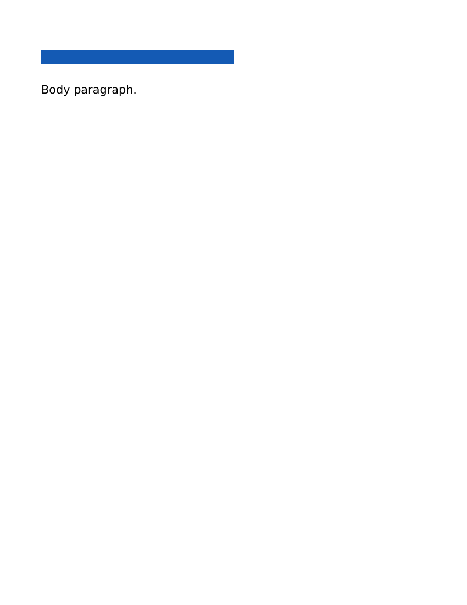
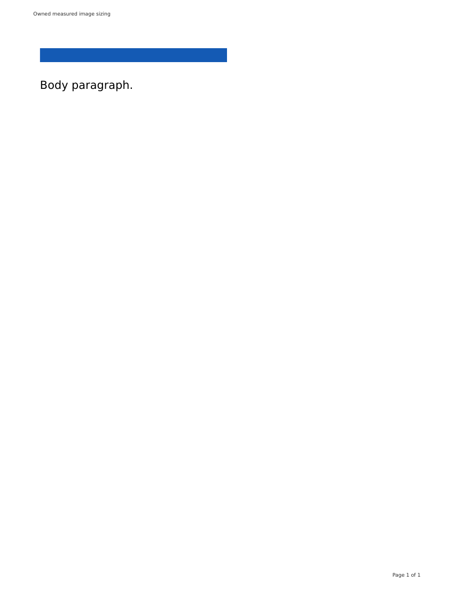

# Source-owned image sizing in heading exports

This source checkpoint advances simple image-only headings. It does not establish full document-image fidelity or qualify an immutable companion/renderer pair.

## Existing failure and physical context

Actual main35fe Word/PDF exports of owned canonical HTML proved that CSS50% and CSS336px images became24pt squares in Word, while browser PDF painted252pt ×18pt. A24px intrinsic PNG without density metadata became24pt instead of18pt. A separately decoded, CRC-verified192DPI PNG became114898EMU (about9.05pt) instead of the browser's18pt. Original source and media bytes stayed unchanged throughout these comparisons.

The ordinary Word color/font page measures at a1280px viewport and canonical MAIN720px; its50% image is360px. Browser PDF's Letter page with54pt margins leaves672CSSpx and paints336px. A width cap alone cannot reproduce that reflow. An actual contained viewport comparison proved the672px MAIN and336px image, with absolute/intrinsic controls unchanged.

## Bounded producer and ownership

The existing1280px color/font pass and browser PDF remain unchanged. A second672px print-media measurement uses the same exact owned stylesheet closure and contributes **only** qualified heading-image geometry. It requires the actual MAIN to match the physical width; root/body/MAIN styles or hidden state, unsupported layout, tall/mixed/multiple images, responsive SRCSET/SIZES and unproved viewport/expression sizing do not acquire that receipt. Existing numeric dimension controls remain qualified.

Conversion-only AST point dimensions preserve measured size without writing the HTML, CSS or original image. The generated source attribute binds the exact IMG to the one Image inside its Header; the source target must match the same MIME and decoded bytes after the observed HTML-to-Pandoc payload normalization. A private owner digest then binds its exact native bookmark range to one inline picture, embed relationship and package-local media bytes. Inline and picture-transform extents must agree with the measured dimensions; missing/wrong assets, duplicate relationships, external references, transformed or borrowed pictures refuse. No text/ordinal matching, rasterized document replacement, blank strut or arbitrary extent relaxation is used.

The byte-proven producer currently accepts bounded base64 PNG/JPEG, including valid omitted padding and ASCII payload whitespace; the actual consumer fixtures below are PNG, so JPEG rendering is not separately qualified here. Other formats retain the previous conversion path rather than receiving an unverified sizing receipt. Unsupported encodings and more complex image contexts remain an explicit follow-up, not a redefinition of the overall goal.

## Evidence and limits

- Shared source regression genuinely failed before physical measurement support. Focused tests cover viewport/context bounds, responsive resource ownership, exact source/AST identity, point dimensions, wrong/missing media and native-transform guards.
- Actual contained source-worker/IIFE overlays on renderer53 produced16 Word/PDF conversions: CSS50%, CSS336px, intrinsic/no-density,192DPI, numeric dimensions, pretty/nested whitespace and NBSP. All source/media hashes stayed unchanged. These are source-overlay proofs, **not** a new immutable-pair qualification.
- The final stricter identity-guard build repeated all16 actual conversions. All eight DOCX package parts matched the consumer-proved prototype byte-for-byte, except only creation/modification timestamps; the existing consumer proof therefore applies to those unchanged native documents. Receipt: `/tmp/document-image-print-qualified/consumer-equivalence.json`.
- Twelve independent LibreOffice conversions retained four old-main visual REDs, passed the unchanged five-pixel image-bounds oracle for seven qualified new cases, and retained the NBSP case as unqualified. DOCX inputs remained unchanged. This is LibreOffice behavior, not Microsoft Word validation.
- The CSS50% Word image changed from a small square to the browser's wide336px image. Body glyph baselines and browser page furniture still differ. Image-only paragraph blocks, mixed text/images, tall/overflow/relative-height cases, responsive candidate selection, SVG/other formats, unusual encodings and orientation/consumer details remain open.

Actual scratch receipts: `/tmp/document-image-print-baseline/results.json`, `/tmp/document-image-print-measure/*/measurement.json`, `/tmp/document-image-print-dpi-control/png-proof.json`, `/tmp/document-image-print-dpi-baseline/results.json`, `/tmp/document-image-print-final/{results.json,office/qualification.json}`. An additional real numeric-SVG compatibility control failed ownership on immutable117 but exported through the new unqualified legacy path; no SVG alignment or pixel-fidelity acceptance is claimed (`/tmp/document-image-svg-compat/results.json`).

The office script's inherited stdout says “GFMimages”; the actual fixtures are canonical **HTML**, as recorded in their input jobs. It is not GFM-specific evidence.

These are owned fake fixtures with no account or sidebar data. Author checks:51 shared cases,110 affected daemon cases, full workspace types and guard passed; the four final test-only physical-context negatives also passed package typechecking. Matching immutable-pair conversion and real app/browser acceptance remain release gates.

## Picture ownership and URI compatibility correction

The original3c checkpoint remains frozen. Its native checks accepted seven malformed/altered fixture pictures with matching media and extents: nested blipFill, srcRect crop, alpha effect, cropped fillRect, ellipse geometry, shadow and visible outline. Seven new refusal assertions genuinely failed before the correction. This is a structural/fidelity guard finding, not a demonstrated exploit.

The correction validates the direct, namespace-aware simple picture produced by pinned **Pandoc3.13**. Its actual source sample is `/tmp/document-image-print-qualified/relative/docx/output/artifact.docx`; `/tmp/document-picture-uri-qualified/canonical-picture-source.json` records its DOCX/document XML hashes and converter version receipts. The owned pic has direct nvPicPr/blipFill/spPr; its bare embedded blip stretches through an empty fillRect; geometry is an uneffected rectangle with zero offset and the converter's invisible outline. Crops, effects, nested fills and changed geometry refuse. Metadata id/name remain required and descr/title optional. Accepted properties are retained, not reconstructed or stripped.

A separate actual comparison found a real3c compatibility regression: immutable117 exported valid unpadded, ASCII-space and CRLF/tab PNG data URIs with unchanged image bytes, while3c refused them. Pinned Pandoc's real Image AST percent-escapes spaces and converts tabs/newlines to escaped whitespace. The corrected source/AST comparison requires the same MIME and decoded SHA after bounded payload normalization. It accepts canonical padding or valid omitted padding, verifies the strict base64 roundtrip including unused bits, and rejects malformed padding/escapes and non-base64 whitespace. It never normalizes an external URL or modifies source bytes. Resolved-owner tests accept the observed escaped targets and reject the same marker with wrong image bytes or changed MIME despite equal bytes.

Correction checks:130 affected daemon cases, full workspace types and guard passed. Eight actual canonical DOCX conversions have every package-part byte equal to the existing consumer-proved3c outputs except creation/modification timestamps, so those consumer checks were not needlessly repeated. Six new URI Word/PDF conversions passed with original source/media hashes unchanged; three new LibreOffice comparisons passed the unchanged five-pixel image-bounds oracle, with DOCX inputs unchanged. This remains source-worker overlay qualification, not an immutable new pair or Microsoft Word acceptance.

Exact receipts: `/tmp/document-picture-ownership-red.log`, `/tmp/document-image-uri-decoder-red.log`, `/tmp/document-image-uri-compat/{results.json,ast-targets.json}`, `/tmp/document-image-uri-fixed/results.json`, `/tmp/document-picture-uri-qualified/{canonical-parts-equivalence.json,uri-office/qualification.json}`. Original failures are retained alongside the qualified correction.
