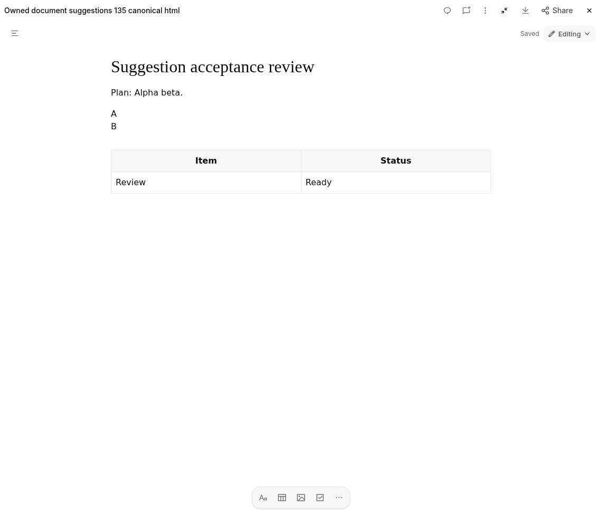
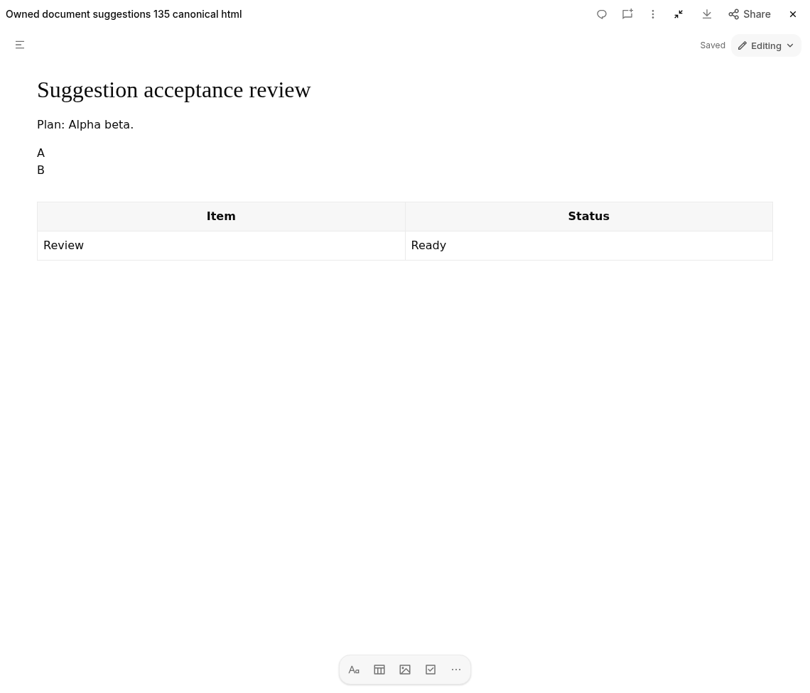
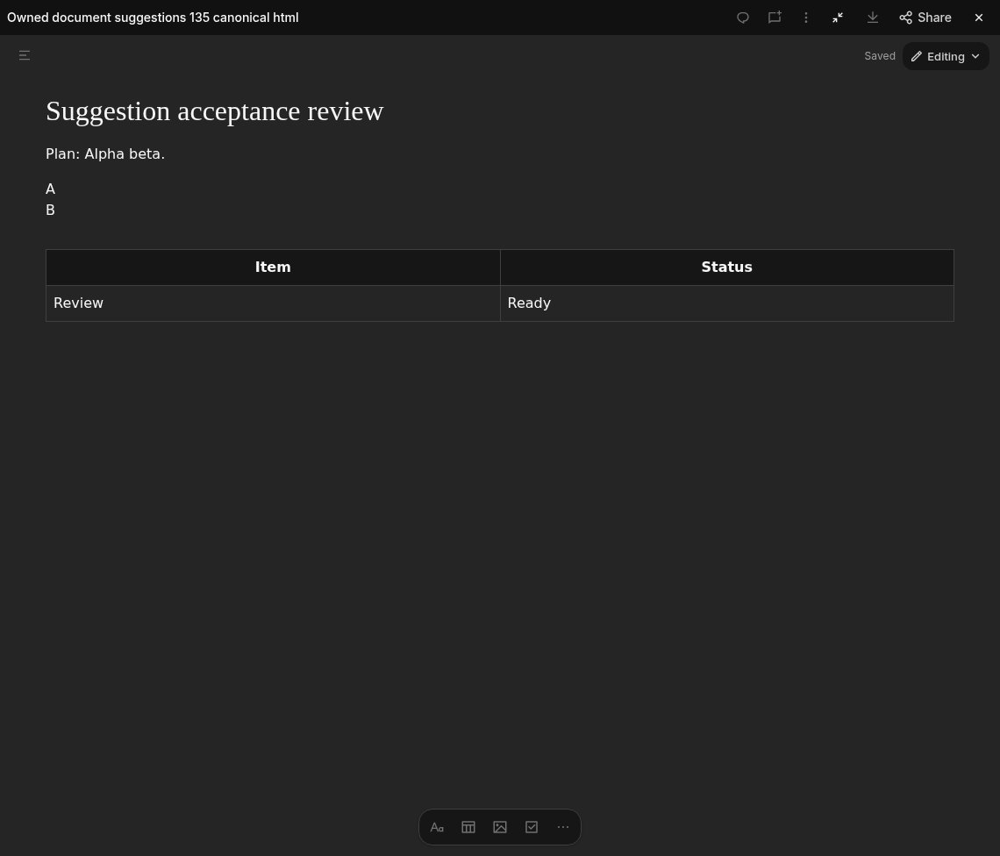

# Document page width

The reference document's More menu exposes “Make page wide”. Our structured
editor now offers that action in its existing More menu, with “Use standard page
width” as the return action. No additional toolbar row is introduced.

Wide mode removes the editor page's 824px cap while retaining its existing
padding and scroll owner. It uses the space left by the sidebar, chat and review
gutter rather than changing those layouts. Phone layouts keep the same padding;
the preference becomes visible when more width is available.

This is a viewer preference, not a source edit. It is stored in browser storage
under the current viewer, project and file identity. It survives an editor
remount in that browser but is not a cross-device account setting. If browser
storage is unavailable, it remains usable for the mounted editor. It does not
alter HTML/Markdown, conditional writes, native selection, text Undo/Redo or
export page geometry. The implementation adds no permission or capability.

The reference menu was inspected read-only; its width action was not invoked.
Its exact persistence, export and history semantics remain unverified, so this
does not claim those match Claude. Date behavior remains a separate gap.

## Source verification

Three mounted-editor cases genuinely failed on unchanged main because the width
action was absent. They now cover source/selection/text-history preservation,
viewer/project/file scoping, remount persistence and unavailable storage. Two
additional cases exercise the actual French and Arabic controls. Existing font,
suggestion and review-placement cases remain intact.

The first post-edit check used the wrong directory for the locale-writing
command, so no catalog entries were written and its missing-label failures are
retained as setup evidence. The final command writes the two keys into all 19
typed catalogs. No assertion or test baseline was loosened.

## Packaged acceptance: local 138/81

The clean source `da8554eb7d5c1e83a0953b094d589bc9ee23abe1` was built as companion
`06e87d1da6d37c5510edc8798d883d34d18d076f02b8e584303226203481b31c`, paired with
renderer `sha256:fe114e141a2dfe953e6d308254b48c8111da2484dc45d38f5fb138a2b40d94a2`.
All builders terminated with exit 0 and no signal. Author and independent strict
checks verified inventory, source/tree identity, actual image bytes/provenance
and runtime entrypoint/user. All five renderer payloads and 2,597 normalized inputs
match 137; no converter job was rerun for this viewer-only change.

The owned preview was loaded with only its three Studio selectors changed.
Every other configuration byte was preserved. Manual Chrome155 checks used the
real More menu, keyboard, theme settings and chat controls:

- At the same 1,140px companion viewport, standard content measured 720px and wide
  content 1,036px. Wide mode kept 52px side padding. Returning to standard restored
  720px. All three actual layouts were personally inspected.
- Wide layout fit the chat-open 640px panel and expanded again correctly. A full
  page reload retained the preference, measured again at 1,036px after Expand.
  The unsent chat draft remained exact through Expand/Restore and that reload;
  it was cleared without sending a message or calling a model.
- Light and Dark desktop/390px views were personally inspected, as was the Dark
  menu. At 390px, Enter opened More and Enter activated the focused width action;
  the next real menu showed the reverse action. The phone layout retains the
  same padding because both widths already fill the available space.
- Original HTML remained byte-identical at SHA
  `59711f617bcd9f7e51bae13b7fcb598dfef3a4e1cd9a1de60a405d3d8018f50d`.
  No source write or converted export was performed. Native selection/history
  preservation is covered by the mounted-editor tests, not relabelled as a new
  complete manual text-history test.

The browser signed out 200 and its subsequent session request returned 401. It
closed normally; a read-only exact-ID query found its captured login session
absent. Light, standard width, empty draft and 1,280×633 viewport were restored.
The local source review found no blocker. Packaged evidence is retained under
`/tmp/artifact138-document-ui/qualification.json` and the immutable pair receipts
under `/tmp/artifact138-{pair-receipt,root-pair-receipt}.json`.

An adjacent observation remains unisolated: immediately clicking Settings Close
after a theme change left the modal visible, while a later click or Escape closed
it. This is recorded rather than counted as a first-click success. It is not a
proved cause or fix in this page-width change.

No complete cross-locale/access/unsaved-edit matrix is claimed. Reference
persistence/export semantics remain unverified. Installer pins, distribution,
production and shared dev were unchanged.
