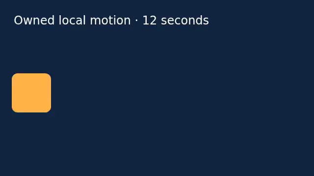
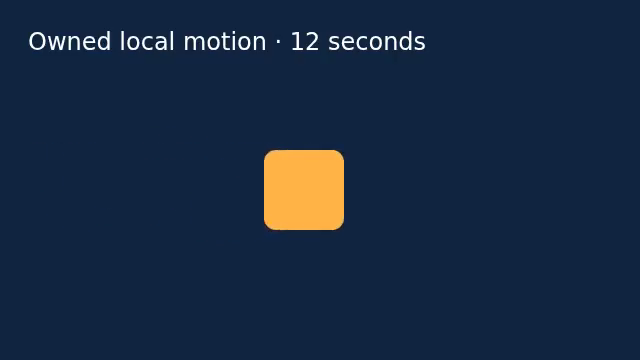
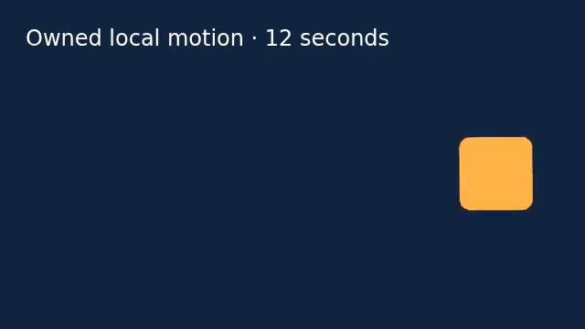
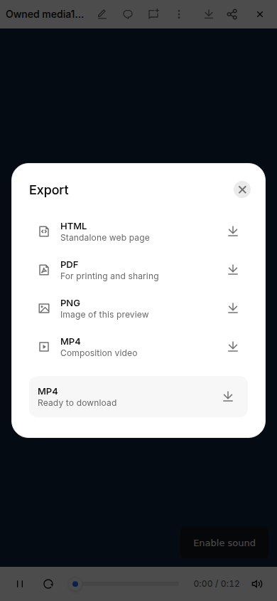

# HyperFrame MP4 acceptance on local 136/79

The normal Export → MP4 flow completed for the existing owned local composition
on **136/79**, fork `9e35cf7e1acfc59d75e65549146c736a79d6c1dd` and native
`45e7b550`. This is bounded actual composition-export acceptance, not a complete
artifact/media goal or permission/crash matrix. The tested pair included separate
unmerged document work; **no standalone build of scoped `6aa452bd` is claimed**.

## Exact source and runtime scope

The companion build was
`3fb9262dfca0ca58433d5366ba539ba7a5cb54330320a31c006dcb47012b5baf`;
renderer image was
`sha256:9fa14462ce2aab6612b1c0c06eda89a0be2e6e95415c1d3b38120cc4ab4bc1f5`.
The strict author and independent pair receipts are retained as
`/tmp/artifact136-pair-receipt.json` and
`/tmp/artifact136-root-pair-receipt.json`.

The [tracked-source comparison](hyperframe-mp4-source-equivalence.json) records
identical Git blobs for thirteen relevant owners between scoped `6aa452bd` and
actual `9e35cf7e`: artifact classification/publication, surface/FileViewer/motion
transport and source player, runner/input/HyperFrame capture/audio/frame bridge,
and the lockfile. Both native export owners match reviewed `06794828` and the
actual native source. The renderer closure is not represented as byte-identical
to the scoped checkpoint: 135 versus base 134 changed only `documents.ts` among
2,597 normalized renderer inputs, adding the document resolve-suggestions guard.
136 versus 135 changed no normalized renderer inputs; all five payloads match
135. That document-only difference remains explicit rather than silently
attributing a whole built pair to `6aa452bd`.

No package publication, installer descriptor, production, codec or authorization
change was performed for this acceptance.

## Actual conversion and independent readback

Only owned TEAM project `6b4de574-663b-4928-ac41-559434b81220` was used. Its
`index.html` declares 640×360 and 12 seconds; a local GSAP timeline moves the
orange box from x=24 toward x=504 while a local MP3 supplies audio.

The actual UI created one job, `5f553caa-2151-435d-ae44-68631d7cf1f9`, with
`format: hyperframes`, `fileName: index.html` and `deck: false`. It reached Ready,
and the real **Download MP4** link saved `artifact.mp4`: **142,778 bytes**, SHA-256
`c86eca8cf4e1c303b3255f77198731977b2f4d8255d18524f65f358459cf978d`.
Both values exactly match the ready job's output metadata.

Independent installed FFprobe/FFmpeg readback found H264 video, **640×360,
12.0 seconds, 30 fps and 360 frames**, with an AAC audio stream. Decoded audio
RMS was nonzero (0.01056); this is not audible-quality qualification. First,
middle and last extracted frames were personally viewed. A separate orange-pixel
oracle measured left edges **24, 264 and 502** at 0, 6 and 359/30 seconds. The last
frame precedes the 12-second endpoint, so x=502 is not relabelled as x=504.

## UI and unchanged source

The compact MP4 row, Ready download and motion controls were personally inspected
in Light and Dark: the wide captures were 1280×633 (Light) and 1440×1000
(Dark), and both narrow captures were 390×844. No identical-width full layout
cross-product is implied. Actual Pause changed the control
to Play; Mute changed it to Unmute. No opaque composition DOM was inspected or
modified, and no source, packet, error or response was injected. This was one
normal backend conversion, not a generation/model call or a source overlay.

Before and after export, authorized raw reads matched every original 133 fixture
byte count and SHA-256:

| File | Bytes | SHA-256 |
| --- | ---: | --- |
| index.html | 842 | `26102667a0839604c7f45686a94e9d20d0e67df5f877bc5eef18779ca76ecb28` |
| gsap.js | 72,779 | `c174bfce53a729418d57a8ad8625e7247c793a22fef8e2851e3cfa3de9cd8280` |
| warm-pad.mp3 | 481,114 | `69ab030c291ffc10b291d6254cb70f0f7c7c2ec896bbb7d3b67a6c167c0d438d` |

## Cleanup and limits

The isolated named Chrome 155 browser restored its initial Light theme, signed
out through JSON (200, then get-session 401) and closed normally with exit 0.
A read-only audit of the one captured exact session found it absent. An initial
premature authentication/navigation attempt had no captured ID; no global or
broader authentication-session cleanup claim is made. No sessions were deleted.
The owned fixture and completed output remain retained.

Local evidence is `/tmp/hyperframe136-ui/qualification.json`, with job metadata,
source reads, `output-oracle.json`, FFprobe output and exact-session audit beside
it. An early stale Settings reference and transition capture were setup errors;
corrected snapshots/captures supplied the final checks. Wide captures containing
host sidebar content stay private; only artifact-only images appear here.
Historical 133/134 playback evidence was not rerun or relabelled. Longer or remote
compositions, broader timing/audio/codec/permission/crash cases and the full media
matrix remain open. No MP4 binary or audio asset is committed by this record.
