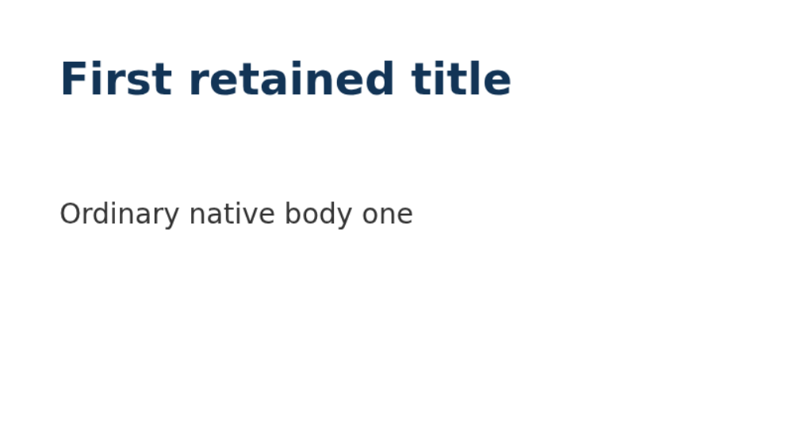
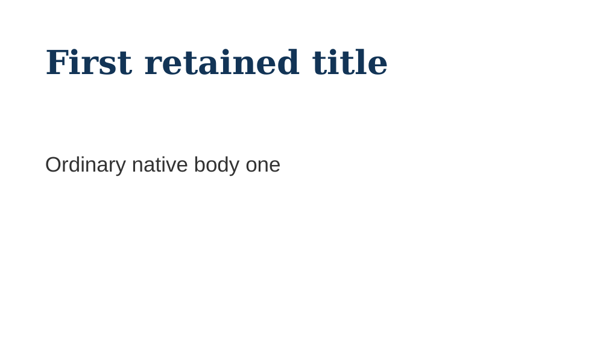

# Bounded deck screenshot capture

Joined source `23fd2051` contains the Fade/Push metadata checkpoint, the reviewed
capture correction `c691b04d`, current Date/image main `9ee0aca2`, and the retained
[original consumer failure](pptx-transition-fidelity.md). The normal merge had no
conflicts. Original transition metadata production files are unchanged; the only
incoming runner change adds the already-reviewed binary-image branch.

## Actual defect and correction

The original immutable worker produced an 800×450 image with the title outside
the capture and three dark corners. Its dimensions-only assertions passed.
The accepted fixture declares 800×450 slide CSS but leaves its canonical stage
at the default 1920×1080; requesting an 800×450 viewport then disabling preview
scaling centered that larger canvas partly outside its clipping ancestor. This
fixture mismatch is retained, not normalized away. The old and corrected default
source bytes have the same SHA-256, and all four original consumer sources match.

Before disabling preview scale, capture now fits its viewport to bounded public
stage geometry. It prefers logical getters, then authored width/height attributes,
then public light-DOM layout sizes for custom stages without those getters.
Valid fractional sizes round outward; source CSS and stage dimensions are never
rewritten. No private shadow canvas or SDK field is read. Legacy decks without a
stage keep their existing path; editable PPTX conversion is unchanged.

The viewport is remeasured after resizing and after each slide navigation before
capture. At most four resizes are permitted, followed by a final stability check.
Geometry beyond the existing 3840×2160 limits, or layout that does not settle,
refuses explicitly. A 200vw responsive slide therefore cannot grow through
screenshot's implicit viewport expansion. The original post-noscale slide count
is retained and bounded. Source-pinned node/digest/visibility checks still run.
Requested dimensions retain their existing viewport/PPTX-page-aspect meaning;
this correction does not claim every aspect-ratio combination is equivalent.

## Qualified source and immutable output

The committed `scripts/test-deck-capture-viewport.ts` genuinely fails against the
original immutable image on decoded corner pixels despite correct dimensions.
On the new immutable image it passes nine cases: default stage, explicit stage,
larger logical stage, custom attributes, custom public layout, legacy deck,
source-pinned PNG, oversized-stage refusal and responsive-growth refusal.
Successes check opaque white corners and more than 100 blue title pixels; actual
titles contain 5,903/6,781 matching pixels. Every source hash stays unchanged.
Only owned source/job/output mounts are used, with the normal worker entrypoint.
There are no worker, dependency or runtime overlays.

Capture/source/transition checks pass 67 cases across six files. Joined checks
pass 221 daemon cases/15 files, 58 contract cases/3 files and 99 shared-policy
cases/8 files. Frozen offline install, full workspace/scripts types and guard
exit 0. These are scoped suites, not full web/daemon runs. An early selector
command ran three actual files/27 cases; its nonexistent fourth selector is not
counted. An earlier `--network=none` image build failed in apt setup; that retained
failure is separate from the authorized normal-network official build.

Both final builder children exit 0 without a signal. The official renderer
context is `/tmp/od-render-pptx-capture-joined-23fd2051`; local ARM64 image
`sha256:f00f26f75189841f83c449c6972c89a87c5acefeedcc321aeae2d96ed96a0bfd`
contains worker `5fec19b298c9c82114167e1b0ddffb45359c9a663851798a994a584ed5d4942e`.
Independent actual-image inventory matches all 586 runtime files and native
hashes. Ten normal immutable binary-image/HTML/PDF controls also pass on this
joined image. A matching companion and fresh native UI are separate gates.

Four additional normal worker jobs pass: editable Fade, screenshot Push, editable
None and explicit Magic Move refusal. Actual output readback retains 350ms Fade/
Push metadata and leftward Push, notes, and editable Georgia/Arial font names.
Three independent LibreOffice profiles exit 0 and produce two-page PDFs. The
corrected Push and editable Fade captures were personally inspected: titles and
bodies are readable and in bounds. Screenshot Push remains a bitmap without a
text layer. Its visible glyph shapes differ from editable Fade; XML font names,
readable text and these captures do not establish installed-font or cross-consumer
font equivalence. The fixture does not bundle those font files.

## Remaining boundaries and cleanup

Microsoft PowerPoint playback, Magic Move/Morph object matching, desktop
transition wiring and general font/export fidelity remain open. This is not a
claim that Magic Move equals Fade, that LibreOffice equals PowerPoint, or that
all native permissions/history/export combinations were replayed. No companion,
preview, pin or publication was changed by this lane.

All owned labeled containers and both worktree process sets are empty; no
Postgres/native stack was started. Build contexts, images and scratch are retained.
The [48-reference evidence](pptx-capture-viewport-evidence.json) records the old
failure, joined source equality, actual worker/consumer results and cleanup.

