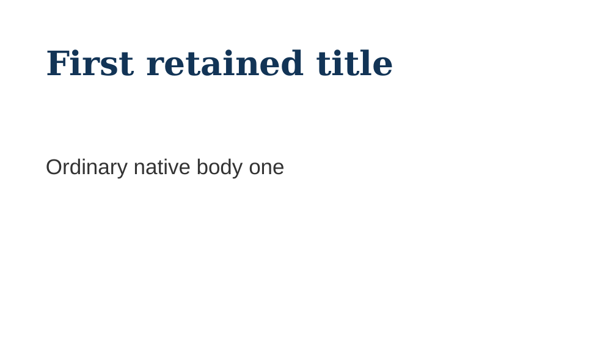

# PowerPoint transition metadata fidelity

This bounded source checkpoint adds standard Fade and Push metadata to the
embedded export path. It is not full presentation parity or a packaged/Office
consumer acceptance claim. The original Date/build worktree remains untouched.

The browser already reads the canonical `deck-stage transition` value, with
350ms timing and forward Push entering from the right. Both worker PowerPoint
branches previously discarded that metadata. Two actual PptxGenJS output tests
failed because no transition node existed. Those same assertions now pass.

The pinned PptxGenJS4.0.1 public typings expose no transition API, and the
vendored dom-to-pptx2.0.1 bundle is unchanged. A conversion-copy OOXML adapter
therefore resolves actual presentation order through relationships, checks the
source/export count, then adds only `p:transition` / `p:fade` or `p:push dir="l"`.
It follows the existing speaker-note package postprocessing pattern. Transition
nodes precede timing/extensions. Existing transitions or ambiguous
AlternateContent, duplicate/external/invalid relationships and mismatched
counts refuse rather than replacing existing content. Legacy sources with no
transition retain the existing byte path.

`p14:dur="350"` carries the browser's existing duration using an ignorable
extension namespace; `spd="fast"` is the older-consumer compatibility value,
not a promise of exact350ms playback in consumers that ignore p14. Microsoft
specifies the duration extension and AlternateContent transition mechanism in
[MS-PPTX Slide Transitions](https://learn.microsoft.com/en-us/openspecs/office_standards/ms-pptx/99b95b35-568a-4652-9cba-df3d1175952f).

The pure source reader accepts only the existing canonical modes and uses the
shared canonical slide collector; authored script/runtime changes cannot add
source metadata. Both editable worker conversion and screenshot worker
conversion invoke the adapter before existing speaker-note projection. The
standalone screenshot builder has an optional bounded transition option.
No rendered object, speaker note, theme or authored file is rewritten.

## Qualified source evidence

Seven new cases plus35 existing notes/deck/source cases passed (42 in4 files).
The real PptxGenJS screenshot tests inspect both exported slides. A separate
real PptxGenJS native-text fixture compares every non-slide ZIP payload exactly,
including theme, relationships and notes. Removing only the newly added
transition from each slide gives the exact original parsed XML; its native text
still reads Georgia24pt/bold with original objects. This proves typed native
fixture retention, not typography produced by dom-to-pptx from browser CSS.
Count, relationship, ambiguity and unsupported controls remain strict.

Frozen install, serial full-workspace types plus scripts TypeScript, guard and
final focused tests all exited0. Initial type failures were limited to authored
test fixtures (required jpeg flag and unsupported theme.lang); the corrected
fixtures retain their substantive assertions. Two wrong-working-directory shell
attempts failed before source writes; the original2failed RED and all logs are
retained in the adjacent eight-reference evidence JSON. No failed attempt is
called a successful conversion.

## Remaining fidelity and carrier gaps

Magic Move uses semantic pairing in the browser. Microsoft specifies native
[CT_MorphTransition](https://learn.microsoft.com/en-us/openspecs/office_standards/ms-pptx/41ca8fbf-efc8-49ac-8a32-7bd0856544bd)
and [morph](https://learn.microsoft.com/en-us/openspecs/office_standards/ms-pptx/68d26d78-f7f5-47ab-835d-4e6c82ff39f0)
metadata, but that alone does not prove matching the same objects. Screenshot
slides also have no editable object identity. This adapter explicitly refuses
Magic Move instead of silently substituting Fade. Native Morph/identity mapping
and actual consumer animation remain implementation/acceptance gaps.

The separate Electron editable capture calls the shared browser converter and
writes its Blob directly. It does not yet use this Node OOXML adapter; desktop
editable transition fidelity remains open. No vendor/SDK patch or cross-app
private import was introduced merely to hide that boundary. New actual
DOM-converter typography readback, worker output/consumer readback and the
Electron carrier must be independently qualified before extending readiness.
No browser, model, runtime, image, publication, release or installer pin action
was performed for this checkpoint.

## Later current-main worker and consumer inspection

The same production patch was isolated onto merged Date main as `1f16042d`.
Frozen install, full serial workspace/scripts types and guard passed. The first
focused command selected two real files (28 cases); two requested names did not
exist. A second command ran the two correct remaining files (14 cases). These
42 cases in four files are source checks, not an export-content visual pass.

The official renderer builder and Docker build exited 0. Four jobs then used
the new immutable image's normal entrypoint with only source/job/output mounts.
Editable Fade and None retain native text, Georgia/Arial font declarations and
speaker notes; screenshot Push retains its transition node; Magic Move refuses
explicitly. Three actual output files opened through independently owned
LibreOffice profiles and produced two-page PDFs. Original source hashes remain
exact. No companion or native browser integration was run for this image.

**Visual inspection found a genuine screenshot capture failure.** The Push
PPTX's embedded PNG is 800×450, but content lies outside the capture: only a
240×135 white corner remains and the rest is black. The canonical stage's
default 1920×1080 canvas is centered inside a smaller requested viewport after
`noscale`, so ancestor clipping hides the authored content. Valid dimensions,
successful conversion and correct transition XML did not catch this. The
worker harness's terminal success is therefore not a visual-acceptance pass.
A bounded geometry correction and real pixel/content regression are required
before this slice is ready. The [readback evidence](pptx-transition-main-evidence.json)
retains exact outputs and logs, including the wrong selector attempt.

This is static LibreOffice consumer evidence, not Microsoft PowerPoint animation
or installed-font equivalence. No preview, installer pin, production service,
publication or hosted CI changed.
