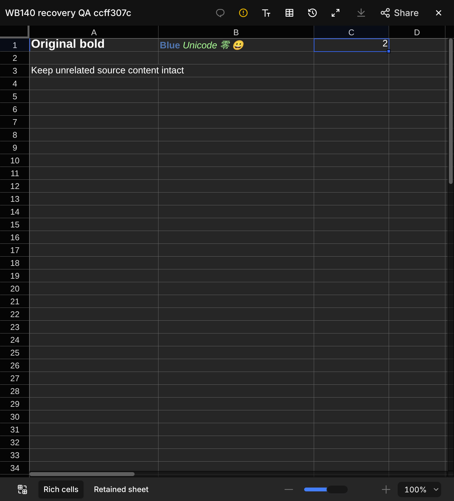
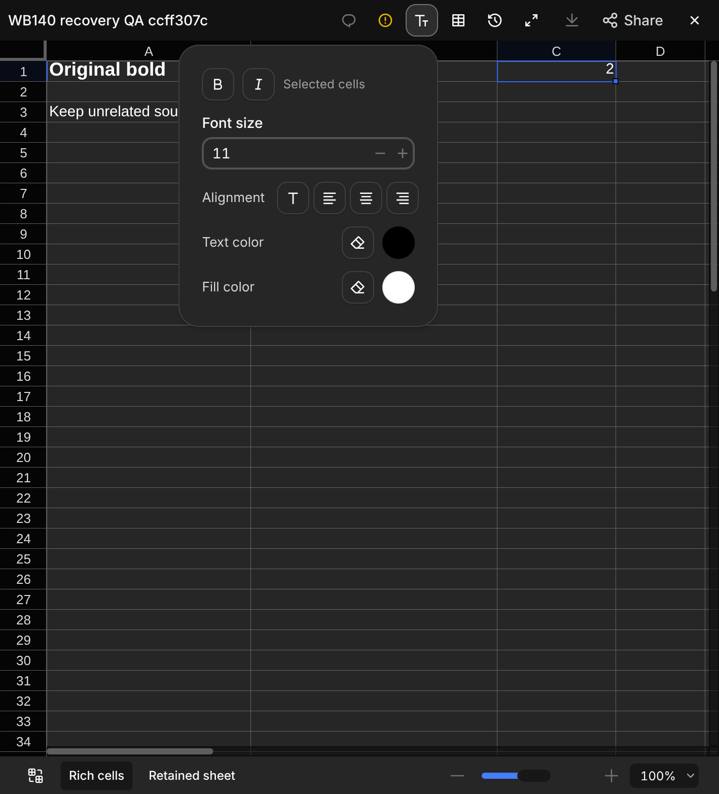

# Sparse horizontal alignment

`WorkbookStyleEdit.horizontalAlignment` optionally carries the source model’s
eight values: `general`, `left`, `center`, `right`, `fill`, `justify`,
`centerContinuous` or `distributed`. The public user-command schema remains
limited to General, Left, Center and Right. Omission retains the source owner;
null and genuinely invalid alignment values refuse. General explicitly writes OOXML `horizontal="general"`
for automatic scalar display. It does not coerce the cell's value or number
format. This additive field does not authorize arbitrary style-index assignment.

The existing style adapter clones the effective cell, custom-row, column or
Normal XF, then changes only its alignment's horizontal attribute and
`applyAlignment`. Font, number format, borders, fill, protection, vertical
alignment, wrapping, rotation, indentation, shrink behavior and unknown retained
XML remain source-owned. Alignment stays before protection/extensions in the XF.
Existing style records and unrelated package parts are immutable; bounded
structural interning deduplicates equal outputs and repeated identical saves.

The pinned ExcelJS reader ignores named-style alignment and application flags.
A shared raw-XF resolver now supplies its private import view and the writer:
explicit false uses the declared parent alignment; an absent local alignment
inherits the parent; an existing local alignment with an omitted flag retains
its established local semantics. Horizontal editing materializes the complete
effective alignment before overriding horizontal, so dormant local properties
cannot suddenly replace parent vertical/wrap/rotation settings. Original package
bytes are retained separately from this importer view. Missing parent references,
ambiguous alignment/table entries, invalid flags and parent counts refuse.
Other font/number-format inheritance policies are unchanged.

Actual XLSX tests first failed because the accepted field was ignored (three
failures, two unchanged controls). Separate named-style cases exposed the pinned
reader's missing inheritance before the shared correction. Tests open emitted
XLSX through ExcelJS independently and inspect raw XF/worksheet XML, retained
original style records, formula caches, rich strings, sibling cells and unrelated
parts. Combined scalar edits still calculate through the existing adapter; a
forged scalar style guard still refuses. Repeated saves do not append styles.

These are source/adapter checks. Native SDK formatting Undo/Redo, actual browser
rendering and packaged qualification belong to the paired grid integration.
Restoring an earlier alignment may reuse or append an equivalent XF; no claim is
made that native Undo restores the entire ZIP byte-for-byte.

## Author checks

The affected reader/style/calculation group passed 64 cases across five files.
The final row-inheritance control was then added; the exact final alignment and
renderer-plan group passed 23 cases across two files. The schema case passed
separately. Full workspace types, repository guard and frozen install exited 0.
Logs are under `/tmp/workbook-alignment-*`. Initial type failures (the private
import view's readonly Map type, then a test's unnarrowed cell union) remain
recorded; the corrections use an explicit private Map and an explicit numeric
fixture kind without weakening an assertion. A setup command from the wrong
working directory did not edit source; genuine failing test logs are separate.

The original source reader/writer tests retain their existing assertions.
Named-style fixtures inspect the unchanged sibling's original raw style owner,
parent and dormant local records as well as the emitted effective alignment.
OOXML vertical `center` continues to normalize to the pinned reader's `middle`;
that test expectation was corrected to the existing public model vocabulary.
No permission, current-source SHA, scalar style guard or package limit changed.

## Restoring a source alignment after Save

The initial four-value internal schema was too restrictive: saving General over
an original Fill, Justify, Center Across Selection or Distributed alignment then
Undoing must restore that exact source value. The sparse plan now reuses the
same eight-value schema as the source model. This is a preservation capability,
not a new user-facing command. The separate four-choice command schema is
unchanged and explicitly tested to refuse the other four values.

Four actual XLSX restoration cases failed against the initial schema while its
12 existing controls passed. Each now saves General, reopens that saved result,
then restores the original alignment through the same calculation/save adapter.
They independently read the emitted alignment, compare the complete original XF,
require retained original style records, reuse the existing original XF without
another append, and preserve unrelated package parts. This models source
restoration; live native Undo ownership remains the grid integration’s task.

The earlier schema/render tests called Justify and Distributed invalid. Those
expectations are replaced with genuinely invalid `diagonal`/`centre`, plus the
stronger real-source restoration cases and explicit UI-only four-choice
refusals. Unknown properties, null, empty edits and source-SHA/style guards still
refuse; no assertion is removed merely to accept an unsupported mutation.

This source-complete follow-up passed 80 affected daemon cases across six files,
both schema cases, full workspace types and repository guard. The four-case
failure log and final checks are retained as
`/tmp/workbook-alignment-source-{restore-red,final-focused,types,guard}.log`.
No browser, native Undo, new package or runtime qualification is implied.

## Native grid commands and live source provenance

The grid now accepts the four-choice horizontal-alignment action and emits an
optional four-choice-or-null state. Automatic uses the pinned public
`SetHorizontalTextAlignCommand` with `HorizontalAlign.UNSPECIFIED` (0), rather
than forcing Left. Mixed or unrepresentable ranges report null. Selection,
parent/origin, controller, editable/saving, rich-cell and existing 100,000-cell
bounds still apply. A proven unchanged choice preserves native Redo; an
unrepresented source alignment is not treated as a no-op.

The pinned facade maps several unsupported alignments to General. A private
kernel registry instead binds each initial source style ID to the exact SDK
style object and source horizontal property. State and sparse planning share
that registry and compose current raw default/row/column/cell owners. The
rendered SheetSkeleton's configured row priority is captured once; its default
is column precedence (default → row → column → cell), whereas a Node-only
Worksheet initially uses row precedence. Actual SDK overlap tests explicitly
set both configurations and compare the real composed result. Derived theme or
interceptor horizontal overrides cannot establish authored no-op provenance.
Unknown or changed objects stay unknown. Moved cells retain their style IDs;
new reader/ACK style ordinals never rename a live SDK origin.

The registry travels privately from Grid readiness to the exact installed
Writer and its planning contexts. A hook-local WeakMap retains it for that
Writer's qualified clean-resume handoff; rejected/stale readiness calls cannot
replace the current Writer's registry. It is never serialized into checkpoints
or files and retires with the kernel. A recovered/new kernel without proof
cannot reconstruct old style authority. An unprovable alignment removal blocks
Save and retains the draft instead of silently writing General.

The original SDK/state/delta cases genuinely failed before implementation.
Additional retained failures exposed partial-row inheritance, false General
for Fill/Center Across Selection, and a rejected-ready handoff race. The latter
regression fails against the intermediate ambient-ref implementation and passes
with exact Writer-keyed ownership. The final affected group passed 108 cases
across seven files, including real SDK commands/native Undo/Redo, row insertion,
both composition priorities, the full selection bound, Writer acknowledgements
with re-compacted reader ordinals, hook handoff, and retained unknown drafts.
The Writer acknowledgement fixtures use explicit legacy receipts; they do not
qualify historical receipt or HTTP authority. Earlier mock API/type/setup
failures remain separately recorded in `/tmp/workbook-alignment-*` logs.

A separate source-integration harness exercised actual SDK commands and native
history against actual XLSX reader/calculation/save adapters: original Right,
Fill and Center Across Selection each changed to General, saved, restored the
original through native Undo and saved, then Redid General and saved. Fresh
ExcelJS readback and independent XML checks verify all nine alignments plus
vertical alignment, wrap, shrink, rotation and indent. Font/number format,
untouched cells and unrelated ZIP parts remain unchanged. Receipts are
`/tmp/workbook-alignment-provenance-{right,fill,centerContinuous}-receipt.json`
and `/tmp/workbook-alignment-provenance-independent-xml.json`. These are actual
source-adapter proofs, not packaged worker, browser, HTTP, lease or transport
qualification. The paired native controls and General → Save → Undo → Save →
Redo lifecycle still require a matching immutable pair and actual UI checks.

Final full workspace types (serial workspace scheduling plus scripts types) and
repository guard exited 0. No app/image build, runtime activation, pin change
or publication was performed for this source checkpoint.

## Actual 139 journal failure and durable presentation data

Actual immutable pair 139 passed the Right cycle, but Fill → General Save →
native Undo → Fill Save stopped before the second HTTP write: the journal
reported that the draft could not be protected. The private live planner knew
the omitted source Fill property; the checkpoint decoder independently derived
the frozen pending plan without that information and correctly refused it.
The prior legacy-ACK-only fixture did not exercise this real journal boundary.
The failed UI evidence remains under
`/tmp/workbook-alignment-pair139-first-ui-results/` and
`/tmp/workbook-alignment-native-pair139-ui.log`; pair 139 is unchanged.

The follow-up adds optional versioned `alignmentData` to the existing checkpoint:
unit ID, captured composition priority, and initial style IDs with their exact
captured SDK definitions plus optional eight-value authored horizontal property.
It includes partial styles needed for inheritance, not just advanced alignments.
This is bounded authored presentation data, not authentication of a historical
source: Fill and Center Across Selection have the same omitted native property.
Self-consistent edited data still faces the ordinary authenticated content-save,
current-source, CAS and server style checks. It never reconstructs a live
registry, native entry issuer, worksheet grant or historical asset authority.

The pure decoder requires the same workbook identity, unique bounded style IDs,
finite horizontal enum and exact definition equality in every protected snapshot.
It uses the existing bounded canonical JSON domain and full draft byte limit.
Explicit native horizontal values take precedence. The pending typed plan must
still equal the independently derived plan exactly; no journal or equality check
is skipped. Old checkpoints without the optional field retain their existing
path; an old unprovable advanced restoration remains refused, not guessed.

A genuine real SDK + Writer + actual draft-store/IndexedDB regression reproduced
the protection failure before the corrective code. The corrected source cases
cover Fill and Center Across Selection through General Save, native Undo Save
and Redo Save, including Normal's host presentation color. Pending recovery
retries the exact frozen intent using data only. Wrong unit/style IDs, duplicate
IDs, changed definitions, data/intent mismatch and missing required data refuse
without replacing the already protected draft. These are source IDB checks with
explicit legacy receipt fixtures, not new packaged/HTTP or real-browser success.

The final affected source group passed 125 cases across eight files. Full
workspace types (serial scheduling plus scripts types), repository guard and
frozen install exited 0. Logs are
`/tmp/workbook-alignment-durable-{red,final-boundaries,types,guard}.log`.
No new image, runtime switch, source mutation in the failing fixture, pin
change or publication is included in this corrective source checkpoint.

### Fresh seeded recovery planning

The first durable-data checkpoint was insufficient for desired-only recovery:
a newly seeded SDK still supplies a live registry, but that registry deliberately
cannot claim the old omitted Fill origin. Its presence shadowed the validated
stored presentation data. A genuine fresh SDK, restored desired snapshot,
`advanced=false` registry and real IndexedDB journal reproduced the refusal;
the pending-intent retry control already passed. Actual pair 139 independently
showed the dirty Fill draft → reload → Restore → Save refusal in
`/tmp/workbook-alignment-native-pair139-recovery-valid-red.log` (the earlier
wrong viewer-key setup attempt is separate, not a product failure).

Pure recovery planning now uses the validated stored data when the supplied
live registry's captured data differs or no registry is supplied. Representation-compatible live data retains the live planner and its retirement
guard. Canonical data equality proves representation compatibility only;
distinct kernels can have equal data. The existing private lease, kernel and
native-history owners independently qualify a clean-resume handoff. Neither path hydrates native origins from stored data. Fresh seeded
SDK tests assert desired-only Save and pending retry, exact typed Fill intent,
empty native Undo/Redo history and an unqualified live registry after saving.
A same-private-registry control still refuses after retirement.

Compatibility is one-way: the new reader accepts old checkpoints without
`alignmentData`; an older strict checkpoint reader rejects that new field even
though the checkpoint version remains 1. An older companion may therefore
refuse to interpret these retained drafts until upgraded. No bidirectional
rollback compatibility or silent draft deletion is claimed.

The fresh-kernel follow-up passed 79 affected cases across four files, web types
and repository guard. Frozen install also exited 0. The first durable checkpoint's
full workspace types/guard results remain separately scoped; this follow-up did
not rerun unrelated daemon suites. At that source checkpoint, packaged recovery acceptance remained open; the bounded later acceptance is recorded below.

## Packaged 140 manual acceptance

The later manual check used frozen fork source
`e263e58036326b3429ff9e8e6de1a73b4b7b0988`, companion 140 build
`0e4a6df1668c9aa9f5919de28bb9a7d8a1252efe35d00fd88c1d8f60b597a7f5`
and renderer 83 image
`sha256:5b09118f6152593188eefc6a7d9e2081ea406b595202ce54b43dd9a6864726d3`.
The retained activation receipt records native
`8b348a79ba09526ae5eca8efb7a93c15ad9dcbfc`; it is not a claim that the later
native checkout was rebuilt or independently requalified at that revision.
All three original builder children exited 0 with no signal. This documentation
child changes no packaged source, payload, runtime selector or installer pin.

A newly created disposable TEAM project, `WB140 recovery QA ccff307c`
(`ccff307c-8c53-4836-87b2-04212337dc01`), used the existing native test recipe:
`studio-rich.xlsx` with C1's imported alignment set to Fill. Manual trusted UI
changed C1 to Automatic, saved and independently read back OOXML General.
Native Undo created an actual committed IndexedDB recovery head for the exact
viewer/project/file. Reload then normal Restore created a fresh grid; normal
Save succeeded and restored OOXML Fill. No Worker termination or seeded draft
was used. Fresh reopen showed a ready canvas, no recovery prompt and no Save.

The independent ZIP/XML oracle matched ten original fields: alignment, XF
attributes, formula, cache, font, fill, other cells, worksheet, other style data
and unrelated package-part payload hashes. All five original style-table
prefixes also matched. This does not promise identical ZIP-container bytes.
At 390px in Dark, C1 Left was saved through the visible 32px Save button (center
hit test passed); raw OOXML confirmed Left. Native Undo and another pointer
Save restored Fill with the same oracle checks. Light/Dark desktop and 390px
captures were personally inspected; the compact formatting dialog and Save
were legible. This is one bounded Fill recovery path, not the full alignment,
history, concurrency or workbook matrix.

A transient `Worksheet controls changed. Try again.` warning was observed
separately; these successful saves do not qualify every worksheet control.
Earlier 140 recovery/formatting attempts remain failed evidence: a native
host-readiness snapshot had Retry and no Studio iframe, a canvas wait failed,
and timeout cleanup also reported a closed page. Their precise original cause
was not established, and they are not rewritten as passing runs or proven
alignment failures.

The disposable project remains saved for inspection, with no active recovery
or dirty Save at final reopen. The original page 8 URL, 1718×806 viewport and Dark
theme were restored; the existing unsent chat draft and its two artifact contexts
were retained. No message was sent. The shared browser context was neither
signed out nor closed, and no new authentication session was created.

`workbook140-acceptance-evidence.json` records 46 independently rehashed scratch
references plus the original build/activation and failed-run receipts. It stores
hashes and scope metadata, not unrelated chat text or private reference content.
Source author checks above remain scoped to their original checkpoints; no
unchanged suite was rerun for this documentation-only acceptance record.

## Review screenshots and final source checks

The actual packaged 140 entry point and formatting popover below were captured
on the same disposable QA workbook without changing its contents. A direct raw
read afterward retained SHA256 `454580aca992173f091b99316b38dc00043e8b8a60f4e082cc3296466845d0c6`.
Only the newly opened capture tab was closed; the original tabs, theme and draft
were preserved. These images include the known native idle worksheet-controls
warning described above, which has a separate native fix; they do not hide it
or imply that the entire management-control flow is qualified.

Before opening the source PR, the final `e263e580` implementation passed a fresh
full workspace `corepack pnpm typecheck` and `corepack pnpm guard`, both exit 0.
No full daemon or web test suite was rerun; the affected source tests above and
actual manual acceptance retain their individual scopes. Documentation/images
are the only changes after this source. No package, pin or publication changed.
