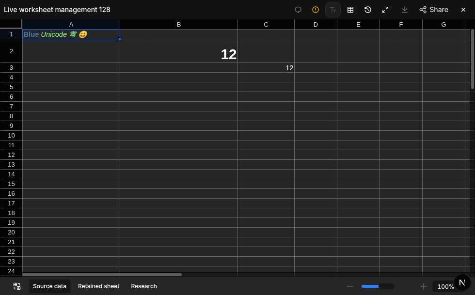

# Live worksheet management: candidate 128

This checkpoint connects the existing **Manage worksheets** host controls to the live private workbook controller. Add, Rename and Delete use negotiated capabilities, correlated results and an opaque controls revision. The frame independently checks the current Writer lease, source, history, permission and calculation owner; host packets and recovered JSON do not issue native worksheet authority.

## Immutable local candidate

Candidate **128/71** was built from clean fork source `345cf770dc93839e1a6a838453d90192d829ba5d`, tree SHA-256 `e0dc4e92fda34a4d4ca2ded1c77a2118c7d359938be60322587a8f84d9a176be`. Later documentation does not change that build identity.

- Companion build: `18e0f9adbe195e1254a3c45191a01a3eea6a39585341f7078083334a6b030c76`.
- Renderer image: `sha256:c193139c05f6cff480bcb743c88ee9bd5471693b9b7acb715a0cbe3f42115689`.
- Renderer worker: `8738267454430638d4168cb570240f81086e5c81fb55e154ef2ac7d43a836e75`, unchanged from 127. The browser calculation worker is a separate Next asset and includes the multi-sheet correction.
- Document-color helper: `497a4acbc82d711f77f9cdf829b6f4e9582d9966a47b216cdf790a58baedae68`, incorporating the separately merged code-color correction. The other three conversion helpers are unchanged from 127.

Both official builders and the standard Docker build exited 0. Strict verification checked the full companion inventory, recomputed authored source identity, matched image provenance, all five actual image file hashes, Linux arm64, the node user and entrypoint. The renderer worker's 2,596 normalized inputs are unchanged from 127. Receipts: `/tmp/workbook-live128-pair-receipt.json`, `/tmp/workbook-live128-builder-terminals.json` and `/tmp/workbook-live128-worker-input-comparison.json`. These temporary paths identify local evidence, not distributed artifacts.

## Actual owned-stack core flow

The named browser used the owned local stack with native source `04b852999f19c29501fef961324c5f3e7bc9d88c` and this exact pair. The made-up workbook contained two original sheets, rich text, a 22.25-point bold cell, a 37-point row and local/cross-sheet formulas. Actual UI actions, raw HTTP readbacks and an independent standard-library ZIP/XML oracle established:

1. Add **Research**, then Save; Undo and Save; Redo with Linux Ctrl+Y and Save. Every uncompressed OOXML part after Redo equals its corresponding first-Add part byte for byte.
2. Rename original **Rich cells** to **Source data** and Save. The dependent cross-sheet formula changed with the name, retaining its result 12.
3. Confirm Delete of original **Retained sheet** and Save; Undo and Save. All three worksheet parts equal the pre-Delete parts byte for byte. The three changed package metadata parts are semantically equal, with ordering differences; this is not whole-archive byte equality.
4. Reload to three healthy sheets without a recovery prompt. The saved file bytes remain exactly unchanged through reload, and unrelated original parts, rich text, dimensions and namespace spelling remain retained.

This manual flow was **dark desktop only**. Ctrl+Shift+Z had no effect; only Ctrl+Y is qualified for Redo here. The browser closed normally. No agent/chat messages, publication, release pins or production changes were involved.

The safe panel-only crop was personally viewed. It shows the restored three-sheet workbook; it does not prove every earlier action. Detailed evidence is `/tmp/workbook-live128-ui/manual-core-flow.json`, the per-step `*-check.json` and raw `.xlsx` files, `redo-part-comparison.json`, `delete-undo-part-comparison.json` and `delete-undo-semantic-comparison.json`.

## Source checks and remaining gates

The source stages have focused actual SDK, Worker/RPC, hook, protocol and contract tests, full workspace typecheck and guard receipts in their linked records. The final multi-sheet correction passed 54 affected cases before its nullable-source type correction; 14 affected cases, full types and guard passed afterward. The combined immutable source then passed full types and guard before building. No new tests were run for this documentation checkpoint.

The preceding 127 Add failure is retained in [multi-sheet result provenance](workbook-multisheet-result-provenance.md); it is not relabeled as a successful run. See also [live host wiring](workbook-live-host-wiring.md), [consumer ownership](workbook-live-membership-consumer.md), [calculation application barrier](workbook-calculation-application-barrier.md), [clean History resume](workbook-clean-history-resume.md), [discarded capture cleanup](workbook-discarded-clean-capture.md) and [negotiated bridge](workbook-membership-host-bridge.md).

Light, narrow, chat/fullscreen and broader visual combinations remain pending for this pair, as do packaged no-effect History handback, access/ownership withdrawal and crash/recovery qualification. Source-level tests do not replace those browser and durability gates. This checkpoint does not qualify arbitrary workbook features, all membership lifecycles, distribution or production readiness.
