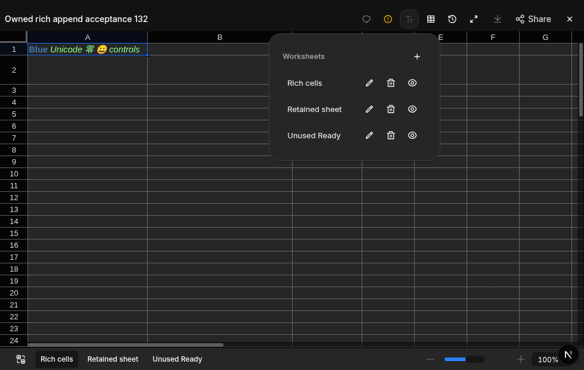

# Experimental worksheet candidate 133/76

This checkpoint qualifies the late correlated readiness-probe routing correction
in the actual owned preview. It does not repeat the [132 browser
matrix](workbook-live132-qualification.md), qualify the complete artifact goal,
or change installer pins 89/35 or production.

## Exact pair

- Clean fork source: `304f8c601de1faa5d4daf34c28e89fbfcad6c87f`.
- Native source: `72f8c5902eec0274c57154460a35b4b62e883ba6`.
- Companion build: `562735328599d6e79811472da58cf1f9f1b88d121a3aea7fffb5f97a4af95800`.
- Renderer image: `sha256:386a08d7fe348a8509a531d92dbbd3cbf6863198756b7cb30934d07d5af8db77`.

Author and independent root verification checked clean source, inventory, actual
image bytes/provenance and platform/entrypoint/user. All five renderer payloads
and 2,597 normalized inputs match 132. The application source differs by the
reviewed late-probe routing correction; the prepared PR's subsequent changes
are documentation only. The 44 affected source cases, types and guard passed
before this build; no tests were rerun to prepare this record.

## Actual late-probe acceptance

The root reopened its existing saved 132 fixture and personally inspected the
normal Manage worksheets menu with New/Rename/Delete already enabled. Only
then, through the existing public protocol, it sent two probes with distinct
new handshake nonces. Each received a matching reply for the exact current
project/controller, same document identity and epoch. This exercises the sole
visibility listener after Grid's early-listener handoff, rather than only the
initial readiness timing that happened to succeed at 132. Public readiness
correlation does not grant private command or source authority.

The saved 7,222-byte workbook stayed at SHA
`37a02a0e04dd77eece8da23ee14445d4fc97685409cf59f963f750dda7f53a22`.
No worksheet mutation was performed for this 133 check. The rich cancel/append,
Rename/Undo/Redo, fresh formula display, fault Restore/Save and raw Markdown
results remain dated 132 evidence, not reruns on 133.

The artifact-only crop was personally inspected and contains no sidebar/chat
content. The yellow header calculation indicator does not establish fresh
initial recalculation. Original stored restore
caches can remain stale until an independently qualified result or checked Save
rebase. The occasional controls-changed notice and the full theme/size/chat,
access, pending-save/history and recovery matrix remain outside this narrow
late-probe result.

## Cleanup and evidence

JSON signout returned 200; the subsequent session request returned 401. The
named browser closed normally and the public observer was disposed. Read-only
queries against the asserted owned 127.0.0.1:6267 `evebot` database found both
exact captured IDs absent: the browser ledger and the final source-readback
helper ledger. No rows were deleted and no global session cleanup is inferred.
An initial session read ran before login/navigation was ready; its failed setup
record had no ID and was retained without guessing an identity or signing in
again.

Scratch receipts: `/tmp/artifact133-root-ui/qualification.json`,
`/tmp/artifact133-root-ui/exact-session-audit.json`,
`/tmp/artifact133-root-pair-receipt.json` and
`/tmp/artifact133-pair-receipt.json`. No build, runtime change or test was run for
this documentation update.
